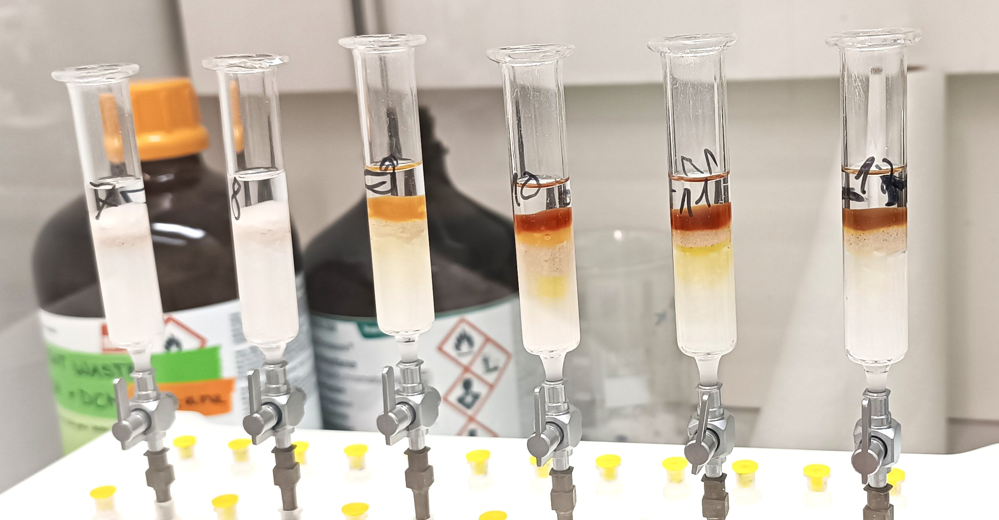

::: {.page-intro}
I welcome conversations about organic geochemistry, lipid biomarkers, paleoclimate, and lake-sediment archives.
:::

::: {.contact-layout}

::: {.contact-main}
### Email

[r.n.santos@unibas.ch](mailto:r.n.santos@unibas.ch){.contact-email}

### Affiliation and postal address

Postdoctoral Researcher in Organic Geochemistry  
Department Surface Waters – Research and Management  
Sedimentology Group  
[Eawag, Swiss Federal Institute of Aquatic Science and Technology](https://www.eawag.ch/en/)  
Überlandstrasse 133  
8600 Dübendorf  
Switzerland
:::

::: {.contact-profiles}
### Research profiles

- [ORCID · 0000-0002-8252-3619 ↗](https://orcid.org/0000-0002-8252-3619)
- [Google Scholar ↗](https://scholar.google.com/citations?user=VAgWEa4AAAAJ&hl=en)
- [GitHub · RicardoANSantos ↗](https://github.com/RicardoANSantos)
- [ResearchGate ↗](https://www.researchgate.net/profile/Ricardo-N-Santos)

### For collaborations

Please include a short description of the project or question, the archive or dataset involved, and any relevant timeline.
:::

:::

```{=html}
<figure class="contact-photo">
  <a href="assets/projects/silica-columns-procedure-rotsee.jpg" aria-label="Open full photograph: Silica columns used for processing Rotsee samples."></a>
</figure>
```
