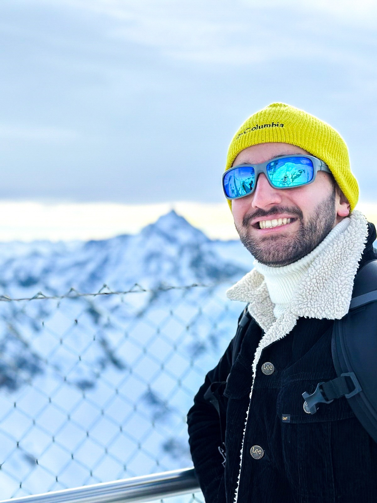

::: {.cv-overview}

::: {.cv-overview-copy}
::: {.page-intro}
Organic geochemist and geologist specializing in lipid biomarkers, compound-specific stable isotopes, and multi-proxy lake-sediment archives.
:::

::: {.download-banner}
[Download my full CV · PDF](assets/Ricardo_CV.pdf){.primary-link} [Last updated: 12 October 2026 (web CV) · PDF edition: October 2026]{.small-note}
:::

## Research expertise

**Lipid biomarker and compound-specific isotope (δ²H, δ¹³C) geochemistry**

- Paleohydroclimate and vegetation reconstruction from lake sediments
- Development and calibration of aquatic and terrestrial biomarker proxies
- Multi-proxy paleolimnology, age–depth modelling and quantitative uncertainty analysis
- Human–environment interactions in Holocene sedimentary records
:::

```{=html}
<figure class="cv-portrait">
<a href="assets/mountain-portrait.jpg" aria-label="Open full winter-retreat portrait"></a>
<figcaption>Organic Geochemistry group retreat, winter in Engelberg.</figcaption>
</figure>
```

:::

## Education

::: {.timeline}

::: {.timeline-item}
**2022–2026 · University of Basel, Switzerland**

### PhD in Organic Geochemistry

Research focus: disentangling vegetation and hydroclimate signals from lipid biomarker records.

Supervisors: [S. Nemiah Ladd](https://duw.unibas.ch/en/research-groups/organic-geochemistry/team/ladd/) and Dominik Fleitmann. Defense anticipated in October 2026.
:::

::: {.timeline-item}
**2019–2021 · University of Lisbon, Portugal**

### MSc in Geology

Stratigraphy, Sedimentology, and Paleontology. Thesis on western Iberian hydroclimate over the last 2,000 years using leaf-wax *n*-alkanes from Lake Peixão.
:::

::: {.timeline-item}
**2018–2019 · University of Lisbon**

### Postgraduate studies in Petroleum Geoscience
:::

::: {.timeline-item}
**2017–2018 · University of Lisbon**

### Postgraduate studies in Applied Geology
:::

::: {.timeline-item}
**2013–2017 · University of Lisbon**

### BSc in Geology

Geology and Natural Resources.
:::

:::

## Research experience

| Period | Role, institution, and research contribution |
|:--|:--|
| 2022–2026 | **Doctoral Candidate & Project Assistant**, Organic Geochemistry Group, University of Basel <span class="cv-role-summary">Lipid biomarkers and compound-specific isotopes to reconstruct climate, vegetation, and human impacts in European and North American lake sediments.</span> |
| 2021–2022 | **Research Fellow**, IPMA, Lisbon <span class="cv-role-summary">Compound-specific δ²H and δ¹³C measurements of modern plant leaf waxes and lake sediments to investigate North Atlantic climate variability.</span> |
| June–September 2021 | **ERASMUS+ Research Intern**, Biología Costera Group, University of A Coruña, Spain <span class="cv-role-summary">Sedimentary diatom analysis.</span> |
| 2019–2021 | **Research Fellow**, FCiências.ID / Instituto Dom Luiz, Lisbon <span class="cv-role-summary">Organic and inorganic lake-sediment proxies to reconstruct atmospheric-circulation influences on western Iberian hydroclimate.</span> |
| 2017–2018 | **Exploration & Production Intern**, Galp Energia, Lisbon <span class="cv-role-summary">Petroleum-potential assessment through seismic interpretation, basin modelling, and organic geochemistry data analysis.</span> |

## Selected awards

- **2022 · EGU Best Blog Post Award, public vote:** [*A glimpse into the INTIMATE Summer School 2022*](https://blogs.egu.eu/divisions/cl/2022/11/21/a-glimpse-into-the-intimates-summer-school-of-2022/).

## Scholarships and competitive support

- **2025 · University of Basel travel grant:** Participation in the Urbino Summer School in Paleoclimatology (USSP), Urbino, Italy.
- **2023 · Swiss Society for Quaternary Research travel grant:** Participation in Goldschmidt, Lyon, France, with the poster *Impact of vegetation dynamics on leaf wax stable isotopes since the Younger Dryas in central Switzerland*.
- **2023 · PAGES travel grant:** Participation in *Numerical ecology and time series analysis of marine proxy data*, Copenhagen, Denmark, led by Dr. Gavin Simpson within Arctic Cryosphere Change and Coastal Marine Ecosystems.
- **2022 · FCT doctoral scholarship:** Awarded by Fundação para a Ciência e a Tecnologia, Portugal; ranked 2nd of 43 applicants in the Earth Sciences panel. Declined the scholarship to take up the PhD position at the University of Basel. Reference: 2022.11839.BD.
- **2022 · INTIMATE travel grant:** Participation in the INTIMATE-INQUA Summer School, Turku, Finland. [Summer school video ↗](https://youtu.be/2F66bkFZ7iA).
- **2019–2020 · Petrobras International Braspetro B.V. postgraduate scholarship:** Master's degree in Geology, University of Lisbon.
- **2018–2019 · Petrobras International Braspetro B.V. postgraduate scholarship:** Postgraduate studies in Petroleum Geoscience, University of Lisbon.

## Analytical and technical expertise

### Laboratory analysis

- **Lipid extraction and preparation:** Accelerated solvent extraction (ASE), ultrasonication, saponification, and derivatization.
- **Compound purification:** Silica-gel and AgNO₃-silica chromatography, and urea adduction.
- **Instrumentation:** GC-FID, GC-MS, and GC-IRMS for compound-specific δ¹³C and δ²H measurements.

### Fieldwork and chronology

- **Sampling:** Lake-sediment coring, core description and sub-sampling, and vegetation and soil sampling.
- **Sediment analysis:** Bulk organic matter, macrofossil picking, diatom preparation, and XRF core scanning.
- **Geochronology:** Radiocarbon dating and ²¹⁰Pb/¹³⁷Cs methods.

### Data analysis and modelling

- **Quantitative methods:** Bayesian age–depth modelling, generalized additive models (GAMs), Monte Carlo uncertainty propagation, and vegetation corrections for plant-wax isotope records.
- **Analysis and visualisation:** R, Grapher, PAST, and Fiji/ImageJ.
- **Mapping and figure preparation:** QGIS/ArcGIS and Adobe Illustrator.

### Open code and data

- **Code:** [Vegetation-correction and isotope-analysis workflows on GitHub](https://github.com/RicardoANSantos/Rotsee_d2Hprc), with the [published version archived on Zenodo](https://doi.org/10.5281/zenodo.18694984).
- **Modern calibration data:** [European plant leaf-wax *n*-alkane δ²H and δ¹³C dataset on Dryad](https://doi.org/10.5061/dryad.cvdncjtj4).
- **Sedimentary data:** [Rotsee plant-wax composition and isotope dataset on PANGAEA](https://doi.org/10.1594/PANGAEA.987812).

**Languages:** Portuguese (native), English and Spanish (fluent), Italian and German (basic, in progress).

## Scientific service and outreach

::: {.cv-peer-review}
**Peer reviewer**

*Quaternary Science Reviews* and *Palaeogeography, Palaeoclimatology, Palaeoecology*.
:::

- **2025–present:** Co-initiator, Younger Dryas Working Group, bringing together researchers across disciplines to synthesise European proxy evidence.
- **2021–2025:** Blog Editor & Outreach Team, [EGU Climate: Past, Present and Future](https://blogs.egu.eu/divisions/cl/category/egu/).
- Research featured in [*O Tempo Preso na Lagoa*, National Geographic Portugal (2023)](https://www.nationalgeographic.pt/meio-ambiente/o-tempo-preso-na-lagoa-do-peixao-na-serra-da-estrela_3781).

## Leadership and civic activities

- **2020–2022 · Newsletter Editor:** [Polar2E – College on Polar and Extreme Environments](https://polar2e.wordpress.com/), University of Lisbon.
- **2018–2019 · Treasurer:** Portuguese Association of Geoscientists and Petroleum Engineers.
- **2017–2018 · President:** [American Association of Petroleum Geologists – University of Lisbon Student Chapter](https://www.facebook.com/ULAAPGSC/about/).
- **2015–2022 · Geological Team Coordinator:** [Kosmonaus Association](https://www.kosmonaus.org/).
- **2015–2017 · Founder and first author:** Geology blog [*Diário de um ProtoGeólogo*](https://proto-geologo.blogspot.com/).

## Training and scientific exchange

- **2025 · EGU General Assembly:** Co-convener of [*Radiocarbon Dating Concepts and Practical Guide*](https://meetingorganizer.copernicus.org/EGU25/session/53629), a short course covering dating principles, sampling, calibration, reservoir corrections, and environmental applications.

## Selected conference contributions

```{=html}
<div class="cv-conferences">
<article class="publication cv-conference">
<p class="cv-conference-meta"><span>IMOG · Porto · 2025</span><span class="cv-conference-type">Oral presentation</span></p>
<h3>Reconstructing Past Precipitation δ²H Values in a Small Swiss Lake: A Vegetation-Corrected Approach using Plant Wax Isotopes</h3>
<p class="authors"><strong>Ricardo N. Santos</strong>, Antonia Klatt, Daniel B. Nelson, Carsten J. Schubert, Nathalie Dubois, Cindy De Jonge, S. Nemiah Ladd</p>
</article>
<article class="publication cv-conference">
<p class="cv-conference-meta"><span>EGU General Assembly · Vienna · 2025</span><span class="cv-conference-type">Oral presentation</span></p>
<h3>Disentangling the impact of vegetation and hydroclimate dynamics on plant wax stable isotopes since the Younger Dryas in Central Switzerland</h3>
<p class="authors"><strong>Ricardo N. Santos</strong>, Antonia Klatt, Daniel B. Nelson, Fatemeh Ajallooeian, Carsten J. Schubert, Nathalie Dubois, Cindy De Jonge, S. Nemiah Ladd</p>
</article>
<article class="publication cv-conference">
<p class="cv-conference-meta"><span>EGU General Assembly · Vienna · 2024</span><span class="cv-conference-type">Poster</span></p>
<h3>Comparison of lipid biomarkers and their hydrogen isotopic values in submerged vascular macrophytes and charophytes</h3>
<p class="authors"><strong>R. N. Santos</strong>, B. Aichner, D. B. Nelson, S. Hilt, S. Nemiah Ladd</p>
</article>
<article class="publication cv-conference">
<p class="cv-conference-meta"><span>22nd Swiss Geoscience Meeting · Basel · 2024</span><span class="cv-conference-type">Poster</span></p>
<h3>Impact of vegetation and hydroclimate dynamics on plant wax stable isotopes since the Younger Dryas in Central Switzerland</h3>
<p class="authors"><strong>Ricardo N. Santos</strong>, Antonia Klatt, Daniel B. Nelson, Fatemeh Ajallooeian, Carsten J. Schubert, Nathalie Dubois, Cindy De Jonge, S. Nemiah Ladd</p>
</article>
<article class="publication cv-conference">
<p class="cv-conference-meta"><span>Goldschmidt · Lyon · 2023</span><span class="cv-conference-type">Poster</span></p>
<h3>Impact of Vegetation Dynamics on Leaf Wax Stable Isotopes Since the Younger Dryas in Central Switzerland</h3>
<p class="authors"><strong>Ricardo N. Santos</strong>, Antonia Klatt, Daniel B. Nelson, Fatemeh Ajallooeian, Carsten J. Schubert, Nathalie Dubois, Cindy De Jonge, S. Nemiah Ladd</p>
</article>
</div>
```

The October 2026 PDF contains the full record of publications, conference contributions, scholarships, and service. [View publications →](publications.qmd)
