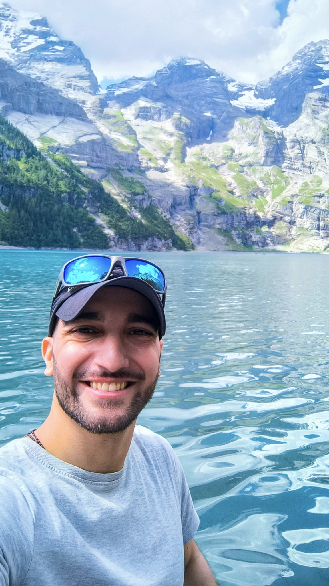

```{=html}
<section class="intro" aria-labelledby="intro-title">
  <div class="intro-copy">
    <p class="eyebrow">ORGANIC GEOCHEMISTRY · PAST CLIMATES &amp; ENVIRONMENTS</p>
    <h1 id="intro-title">Ricardo N. Santos</h1>
    <p class="position">Organic geochemist</p>
    <p class="affiliation">University of Basel, Switzerland</p>
    <p class="intro-lead"><em>Reading the past through sedimentary lipid biomarkers.</em></p>
    <p>I’m a geologist by training, using lipid biomarkers and compound-specific stable isotope analyses to reconstruct past climates and environments from lake-sediment archives. I study how hydroclimate, vegetation, and human activity have shaped landscapes and lake ecosystems from the last deglaciation to the present.</p>
    <p>What fascinates me is how organic geochemistry allows us to explore connections between the biosphere, hydrosphere, atmosphere, and geosphere—and how sediments preserve evidence of those relationships through time. A single sedimentary lipid record can reflect the intertwined histories of climate, terrestrial vegetation, aquatic ecosystems, and human activity. My research explores how to disentangle these influences and understand the processes that shape biomarker signals. I focus particularly on refining our lipid biomarker toolkit to improve our ability to reconstruct long‑term environmental change, while making the uncertainties in those interpretations explicit.</p>
    <div class="profile-links" aria-label="Professional profiles">
      <a href="https://orcid.org/0000-0002-8252-3619">ORCID ↗</a>
      <a href="https://scholar.google.com/citations?user=VAgWEa4AAAAJ&amp;hl=en">Google Scholar ↗</a>
      <a href="https://github.com/RicardoANSantos">GitHub ↗</a>
      <a href="https://www.researchgate.net/profile/Ricardo-N-Santos">ResearchGate ↗</a>
      <a href="https://bsky.app/profile/ricardoansantos.bsky.social">Bluesky ↗</a>
      <a href="https://x.com/RicardoANSantos">X ↗</a>
      <a href="https://www.linkedin.com/in/ricardo-neves-dos-santos/">LinkedIn ↗</a>
    </div>
    <div class="intro-actions">
      <a class="primary-link" href="research.html">Explore my research <span aria-hidden="true">→</span></a>
    </div>
  </div>
  <figure class="portrait">
    
    <figcaption>Summer 2025 · Away from the lab</figcaption>
  </figure>
</section>
<section class="research-intro" aria-labelledby="research-title">
  <div class="section-heading"><p class="eyebrow">RESEARCH FOCUS</p><h2 id="research-title">Lipid biomarker toolkit</h2></div>
  <div class="focus-grid">
    <div><span class="focus-number">01</span><h3>Modern calibration &amp; proxy development</h3><p>Understanding modern lipid sources and isotope signals to refine environmental proxies and make uncertainties in their interpretation explicit.</p></div>
    <div><span class="focus-number">02</span><h3>Past hydroclimate</h3><p>Using sedimentary plant-wax hydrogen isotopes to investigate past hydroclimate, while accounting for changes in vegetation and lipid sources.</p></div>
    <div><span class="focus-number">03</span><h3>Ecosystem &amp; landscape reconstruction</h3><p>Tracing changes in terrestrial vegetation, lake ecology, and human land use through lipid biomarkers and complementary sedimentary evidence.</p></div>
  </div>
</section>
<section class="selected-work" aria-labelledby="selected-title">
  <div class="section-heading split-heading"><div><p class="eyebrow">SELECTED PUBLICATIONS</p><h2 id="selected-title">Recent work</h2></div><a href="publications.html">Publications &amp; outreach →</a></div>
  <article class="featured-paper">
    <div class="paper-meta">2026 <span>Paleoceanography and Paleoclimatology</span></div>
    <h3><a href="https://doi.org/10.1029/2025PA005401">Central European Hydroclimate Since the Younger Dryas Inferred From Vegetation-Corrected Sedimentary Plant Wax δ²H Values</a></h3>
    <p>Separating vegetation effects from hydroclimatic information in a Swiss lake-sediment record.</p>
    <a class="doi-link" href="https://doi.org/10.1029/2025PA005401">Read paper ↗</a>
  </article>
  <article class="featured-paper">
    <div class="paper-meta">2024 <span>Quaternary Science Reviews</span></div>
    <h3><a href="https://doi.org/10.1016/j.quascirev.2024.108796">Understanding the Atlantic influence on climate and vegetation dynamics in western Iberia over the last 2000 years</a></h3>
    <p>A multi-proxy reconstruction of climate and vegetation change in western Iberia.</p>
    <a class="doi-link" href="https://doi.org/10.1016/j.quascirev.2024.108796">Read paper ↗</a>
  </article>
</section>
<aside class="contact-strip"><p>Interested in lipid biomarkers, paleoclimate, or lake sediments?</p><a href="contact.html">Let’s get in touch →</a></aside>
```
