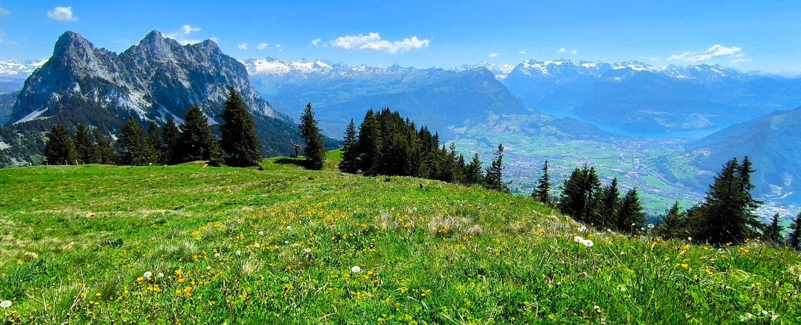

```{=html}
<section class="intro" aria-labelledby="intro-title">
  <div class="intro-copy">
    <div class="intro-heading">
    <p class="eyebrow">ORGANIC GEOCHEMISTRY · PAST CLIMATES &amp; ENVIRONMENTS</p>
    <h1 id="intro-title">Ricardo N. Santos</h1>
    <p class="position">Organic geochemist</p>
    <p class="affiliation"><a href="https://duw.unibas.ch/en/research-groups/organic-geochemistry/">Organic Geochemistry Group · University of Basel, Switzerland</a></p>
    </div>
    <div class="intro-biography">
    <p class="intro-lead"><em>Reading the past through sedimentary lipid biomarkers</em></p>
    <p>I’m a geologist by training, using lipid biomarkers and compound-specific stable isotope analyses to reconstruct past climates and environments from lake-sediment archives. I study how hydroclimate, vegetation, and human activity have shaped landscapes and lake ecosystems from the last deglaciation to the present.</p>
    <p>What fascinates me is how organic geochemistry allows us to explore connections between the biosphere, hydrosphere, atmosphere, and geosphere, and how sediments preserve evidence of those relationships through time. A single sedimentary lipid record can reflect the intertwined histories of climate, terrestrial vegetation, aquatic ecosystems, and human activity.</p>
    <p>My research explores how to disentangle these influences and understand the processes that shape biomarker signals. I focus particularly on refining our lipid biomarker toolkit to improve our ability to reconstruct long‑term environmental change, while making the uncertainties in those interpretations explicit.</p>
    </div>
    <div class="intro-links">
    <div class="profile-links" aria-label="Professional profiles">
      <a href="https://orcid.org/0000-0002-8252-3619"><svg class="profile-icon profile-icon--orcid" width="18" height="18" aria-hidden="true" focusable="false" xmlns="http://www.w3.org/2000/svg" viewBox="0 0 512 512"><!--! Font Awesome Free 7.3.1 by @fontawesome - https://fontawesome.com License - https://fontawesome.com/license/free (Icons: CC BY 4.0, Fonts: SIL OFL 1.1, Code: MIT License) Copyright 2026 Fonticons, Inc. --><path fill="currentColor" d="M294.7 188.2l-45.9 0 0 153.8 47.5 0c67.6 0 83.1-51.3 83.1-76.9 0-41.6-26.5-76.9-84.7-76.9zM256 8a248 248 0 1 0 0 496 248 248 0 1 0 0-496zM175.2 368.8l-29.8 0 0-207.5 29.8 0 0 207.5zM160.3 98.5a19.6 19.6 0 1 1 0 39.2 19.6 19.6 0 1 1 0-39.2zM300 369l-81 0 0-207.7 80.6 0c76.7 0 110.4 54.8 110.4 103.9 0 53.3-41.7 103.9-110 103.9z"/></svg><span>ORCID</span> <span aria-hidden="true">↗</span></a>
      <a href="https://scholar.google.com/citations?user=VAgWEa4AAAAJ&amp;hl=en"><svg class="profile-icon" width="18" height="18" aria-hidden="true" focusable="false" xmlns="http://www.w3.org/2000/svg" viewBox="0 0 512 512"><!--! Font Awesome Free 7.3.1 by @fontawesome - https://fontawesome.com License - https://fontawesome.com/license/free (Icons: CC BY 4.0, Fonts: SIL OFL 1.1, Code: MIT License) Copyright 2026 Fonticons, Inc. --><path fill="currentColor" d="M390.9 298.5s0 .1 .1 .1c9.2 19.4 14.4 41.1 14.4 64-.1 82.5-66.9 149.4-149.4 149.4S106.7 445.1 106.7 362.7c0-22.9 5.2-44.6 14.4-64 1.7-3.6 3.6-7.2 5.6-10.7 4.4-7.6 9.4-14.7 15-21.3 27.4-32.6 68.5-53.3 114.4-53.3 33.6 0 64.6 11.1 89.6 29.9 9.1 6.9 17.4 14.7 24.8 23.5 5.6 6.6 10.6 13.8 15 21.3 2 3.4 3.8 7 5.5 10.5l-.1-.1zm26.4-18.8c-30.1-58.4-91-98.4-161.3-98.4s-131.2 40-161.3 98.4l-94.7-77 256-202.7 256 202.7-94.7 77.1 0-.1z"/></svg><span>Google Scholar</span> <span aria-hidden="true">↗</span></a>
      <a href="https://github.com/RicardoANSantos"><svg class="profile-icon" width="18" height="18" aria-hidden="true" focusable="false" xmlns="http://www.w3.org/2000/svg" viewBox="0 0 512 512"><!--! Font Awesome Free 7.3.1 by @fontawesome - https://fontawesome.com License - https://fontawesome.com/license/free (Icons: CC BY 4.0, Fonts: SIL OFL 1.1, Code: MIT License) Copyright 2026 Fonticons, Inc. --><path fill="currentColor" d="M216.5 362.5c-66-8-112.5-55.5-112.5-117 0-25 9-52 24-70-6.5-16.5-5.5-51.5 2-66 20-2.5 47 8 63 22.5 19-6 39-9 63.5-9s44.5 3 62.5 8.5c15.5-14 43-24.5 63-22 7 13.5 8 48.5 1.5 65.5 16 19 24.5 44.5 24.5 70.5 0 61.5-46.5 108-113.5 116.5 17 11 28.5 35 28.5 62.5l0 52C323 491.5 335.5 500 350.5 494 441 459.5 512 369 512 257 512 115.5 397 0 255.5 0S0 115.5 0 257c0 111 70.5 203 165.5 237.5 13.5 5 26.5-4 26.5-17.5l0-40c-7 3-16 5-24 5-33 0-52.5-18-66.5-51.5-5.5-13.5-11.5-21.5-23-23-6-.5-8-3-8-6 0-6 10-10.5 20-10.5 14.5 0 27 9 40 27.5 10 14.5 20.5 21 33 21s20.5-4.5 32-16c8.5-8.5 15-16 21-21z"/></svg><span>GitHub</span> <span aria-hidden="true">↗</span></a>
      <a href="https://www.researchgate.net/profile/Ricardo-N-Santos"><svg class="profile-icon" width="18" height="18" aria-hidden="true" focusable="false" xmlns="http://www.w3.org/2000/svg" viewBox="0 0 448 512"><!--! Font Awesome Free 7.3.1 by @fontawesome - https://fontawesome.com License - https://fontawesome.com/license/free (Icons: CC BY 4.0, Fonts: SIL OFL 1.1, Code: MIT License) Copyright 2026 Fonticons, Inc. --><path fill="currentColor" d="M0 32l0 448 448 0 0-448-448 0zM262.2 366.4c-6.6 3-33.2 6-50-14.2-9.2-10.6-25.3-33.3-42.2-63.6-8.9 0-14.7 0-21.4-.6l0 46.4c0 23.5 6 21.2 25.8 23.9l0 8.1c-6.9-.3-23.1-.8-35.6-.8-13.1 0-26.1 .6-33.6 .8l0-8.1c15.5-2.9 22-1.3 22-23.9l0-109.4c0-22.6-6.4-21-22-23.9l0-8.1c25.8 1 53.1-.6 70.9-.6 31.7 0 55.9 14.4 55.9 45.6 0 21.1-16.7 42.2-39.2 47.5 13.6 24.2 30 45.6 42.2 58.9 7.2 7.8 17.2 14.7 27.2 14.7l0 7.3zm22.9-135c-23.3 0-32.2-15.7-32.2-32.2l0-32.2c0-12.2 8.8-30.4 34-30.4s30.4 17.9 30.4 17.9l-10.7 7.2s-5.5-12.5-19.7-12.5c-7.9 0-19.7 7.3-19.7 19.7l0 26.8c0 13.4 6.6 23.3 17.9 23.3 14.1 0 21.5-10.9 21.5-26.8l-17.9 0 0-10.7 30.4 0c0 20.5 4.7 49.9-34 49.9zM168.6 276.1c-9.4 0-13.6-.3-20-.8l0-69.7c6.4-.6 15-.6 22.5-.6 23.3 0 37.2 12.2 37.2 34.5 0 21.9-15 36.6-39.7 36.6z"/></svg><span>ResearchGate</span> <span aria-hidden="true">↗</span></a>
      <a href="https://bsky.app/profile/ricardoansantos.bsky.social"><svg class="profile-icon" width="18" height="18" aria-hidden="true" focusable="false" xmlns="http://www.w3.org/2000/svg" viewBox="0 0 576 512"><!--! Font Awesome Free 7.3.1 by @fontawesome - https://fontawesome.com License - https://fontawesome.com/license/free (Icons: CC BY 4.0, Fonts: SIL OFL 1.1, Code: MIT License) Copyright 2026 Fonticons, Inc. --><path fill="currentColor" d="M407.8 294.7c-3.3-.4-6.7-.8-10-1.3 3.4 .4 6.7 .9 10 1.3zM288 227.1C261.9 176.4 190.9 81.9 124.9 35.3 61.6-9.4 37.5-1.7 21.6 5.5 3.3 13.8 0 41.9 0 58.4S9.1 194 15 213.9c19.5 65.7 89.1 87.9 153.2 80.7 3.3-.5 6.6-.9 10-1.4-3.3 .5-6.6 1-10 1.4-93.9 14-177.3 48.2-67.9 169.9 120.3 124.6 164.8-26.7 187.7-103.4 22.9 76.7 49.2 222.5 185.6 103.4 102.4-103.4 28.1-156-65.8-169.9-3.3-.4-6.7-.8-10-1.3 3.4 .4 6.7 .9 10 1.3 64.1 7.1 133.6-15.1 153.2-80.7 5.9-19.9 15-138.9 15-155.5s-3.3-44.7-21.6-52.9c-15.8-7.1-40-14.9-103.2 29.8-66.1 46.6-137.1 141.1-163.2 191.8z"/></svg><span>Bluesky</span> <span aria-hidden="true">↗</span></a>
      <a href="https://x.com/RicardoANSantos"><svg class="profile-icon" width="18" height="18" aria-hidden="true" focusable="false" xmlns="http://www.w3.org/2000/svg" viewBox="0 0 448 512"><!--! Font Awesome Free 7.3.1 by @fontawesome - https://fontawesome.com License - https://fontawesome.com/license/free (Icons: CC BY 4.0, Fonts: SIL OFL 1.1, Code: MIT License) Copyright 2026 Fonticons, Inc. --><path fill="currentColor" d="M357.2 48L427.8 48 273.6 224.2 455 464 313 464 201.7 318.6 74.5 464 3.8 464 168.7 275.5-5.2 48 140.4 48 240.9 180.9 357.2 48zM332.4 421.8l39.1 0-252.4-333.8-42 0 255.3 333.8z"/></svg><span>X</span> <span aria-hidden="true">↗</span></a>
      <a href="https://www.linkedin.com/in/ricardo-neves-dos-santos/"><svg class="profile-icon" width="18" height="18" aria-hidden="true" focusable="false" xmlns="http://www.w3.org/2000/svg" viewBox="0 0 448 512"><!--! Font Awesome Free 7.3.1 by @fontawesome - https://fontawesome.com License - https://fontawesome.com/license/free (Icons: CC BY 4.0, Fonts: SIL OFL 1.1, Code: MIT License) Copyright 2026 Fonticons, Inc. --><path fill="currentColor" d="M100.3 448l-92.9 0 0-299.1 92.9 0 0 299.1zM53.8 108.1C24.1 108.1 0 83.5 0 53.8 0 39.5 5.7 25.9 15.8 15.8s23.8-15.8 38-15.8 27.9 5.7 38 15.8 15.8 23.8 15.8 38c0 29.7-24.1 54.3-53.8 54.3zM447.9 448l-92.7 0 0-145.6c0-34.7-.7-79.2-48.3-79.2-48.3 0-55.7 37.7-55.7 76.7l0 148.1-92.8 0 0-299.1 89.1 0 0 40.8 1.3 0c12.4-23.5 42.7-48.3 87.9-48.3 94 0 111.3 61.9 111.3 142.3l0 164.3-.1 0z"/></svg><span>LinkedIn</span> <span aria-hidden="true">↗</span></a>
    </div>
    <div class="intro-actions">
      <a class="primary-link" href="research.html">Explore my research <span aria-hidden="true">→</span></a>
    </div>
    </div>
  </div>
  <figure class="portrait">
    
    <figcaption>Summer 2025 · Away from the lab</figcaption>
  </figure>
</section>
<section class="research-intro" aria-labelledby="research-title">
  <div class="toolkit-heading">
    <div class="section-heading"><p class="eyebrow">RESEARCH FOCUS</p><h2 id="research-title">Lipid biomarker toolkit</h2></div>
    <figure class="toolkit-photo"><a href="assets/photos/lipid-biomarker-toolkit-landscape.jpeg" aria-label="Open full Hochstuckli landscape photograph"></a><figcaption>© Ricardo N. Santos · Hochstuckli, Schwyz, Switzerland</figcaption></figure>
  </div>
  <div class="focus-grid">
    <div><span class="focus-icon" aria-hidden="true"><svg viewBox="0 0 24 24" width="32" height="32" fill="none" stroke="currentColor" stroke-width="1.5" stroke-linecap="round" stroke-linejoin="round" focusable="false"><path d="M9 3h6M10 3v6L4.5 18.5Q3.1 21 6 21h12q2.9 0 1.5-2.5L14 9V3"/><path d="M7 15h10"/></svg></span><h3>Modern calibration &amp; proxy development</h3><p>Understanding modern lipid sources and isotope signals to refine environmental proxies and make uncertainties in their interpretation explicit.</p></div>
    <div><span class="focus-icon" aria-hidden="true"><svg viewBox="0 0 24 24" width="32" height="32" fill="none" stroke="currentColor" stroke-width="1.5" stroke-linecap="round" stroke-linejoin="round" focusable="false"><path d="M12 3C10 6 5 11 5 15a7 7 0 0 0 14 0C19 11 14 6 12 3Z"/><path d="M8 16c2-2 6 2 8 0"/></svg></span><h3>Past hydroclimate</h3><p>Using sedimentary plant-wax hydrogen isotopes to investigate past hydroclimate, while accounting for changes in vegetation and lipid sources.</p></div>
    <div><span class="focus-icon" aria-hidden="true"><svg viewBox="0 0 24 24" width="32" height="32" fill="none" stroke="currentColor" stroke-width="1.5" stroke-linecap="round" stroke-linejoin="round" focusable="false"><path d="M3 20h18M3 20l5-8 5 8M17 14v6"/><path d="m17 4-5 10h10Z"/></svg></span><h3>Ecosystem &amp; landscape reconstruction</h3><p>Tracing changes in terrestrial vegetation, lake ecology, and human land use through lipid biomarkers and complementary sedimentary evidence.</p></div>
  </div>
</section>
<section class="selected-work" aria-labelledby="selected-title">
  <div class="section-heading split-heading"><div><p class="eyebrow">SELECTED PUBLICATIONS</p><h2 id="selected-title">Recent work</h2></div><a href="publications.html">Publications &amp; outreach →</a></div>
  <article class="featured-paper">
    <div class="paper-meta">2026 <span>Paleoceanography and Paleoclimatology</span></div>
    <h3><a href="https://doi.org/10.1029/2025PA005401">Central European Hydroclimate Since the Younger Dryas Inferred From Vegetation-Corrected Sedimentary Plant Wax δ²H Values</a></h3>
    <p>Separating vegetation effects from hydroclimatic information in a Swiss lake-sediment record.</p>
    <a class="doi-link" href="https://doi.org/10.1029/2025PA005401">Read paper ↗</a>
  </article>
  <article class="featured-paper">
    <div class="paper-meta">2024 <span>Quaternary Science Reviews</span></div>
    <h3><a href="https://doi.org/10.1016/j.quascirev.2024.108796">Understanding the Atlantic influence on climate and vegetation dynamics in western Iberia over the last 2000 years</a></h3>
    <p>A multi-proxy reconstruction of climate and vegetation change in western Iberia.</p>
    <a class="doi-link" href="https://doi.org/10.1016/j.quascirev.2024.108796">Read paper ↗</a>
  </article>
</section>
<aside class="contact-strip"><p>Interested in lipid biomarkers, paleoclimate, or lake sediments?</p><a href="contact.html">Let’s get in touch →</a></aside>
```
