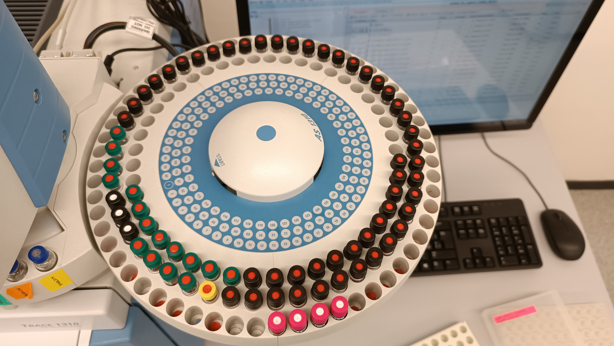
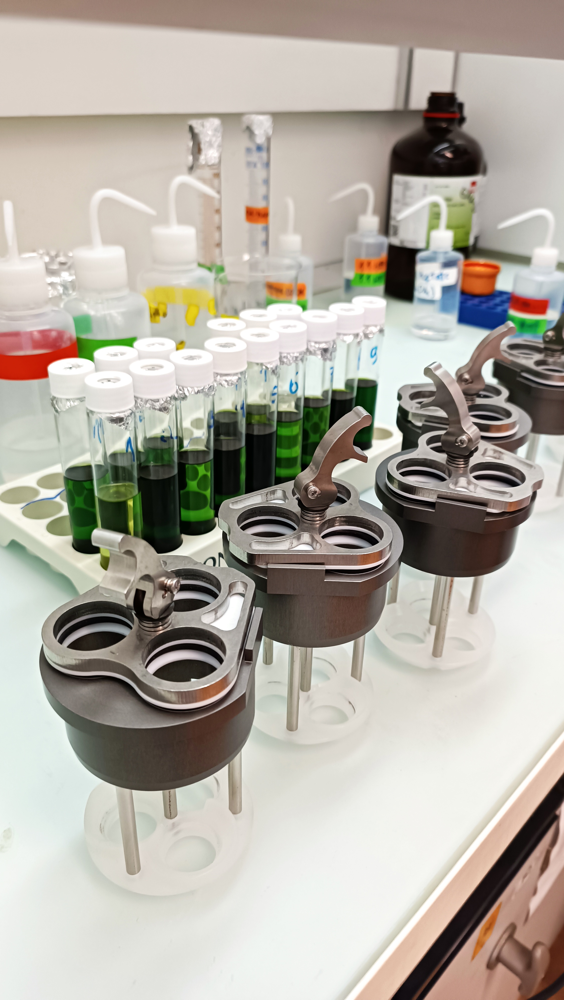
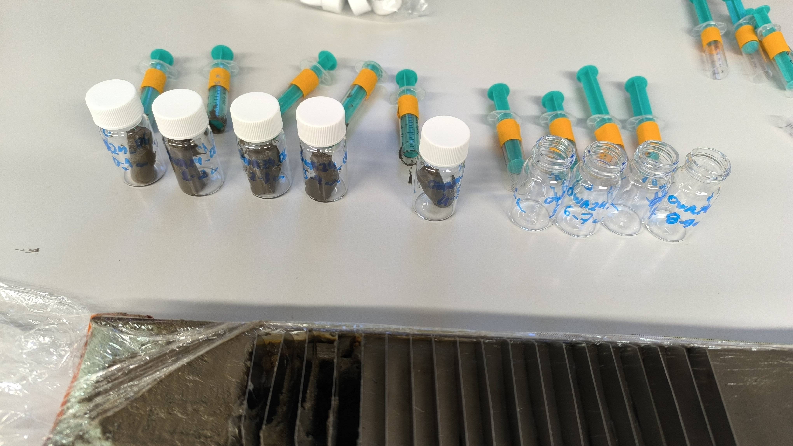
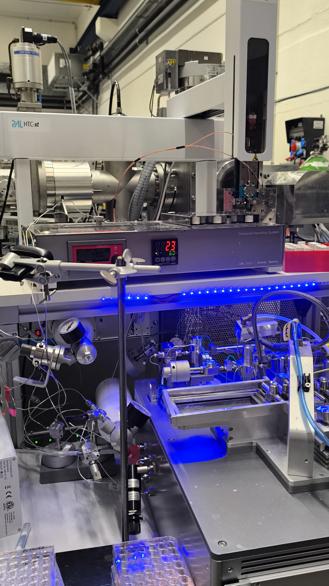
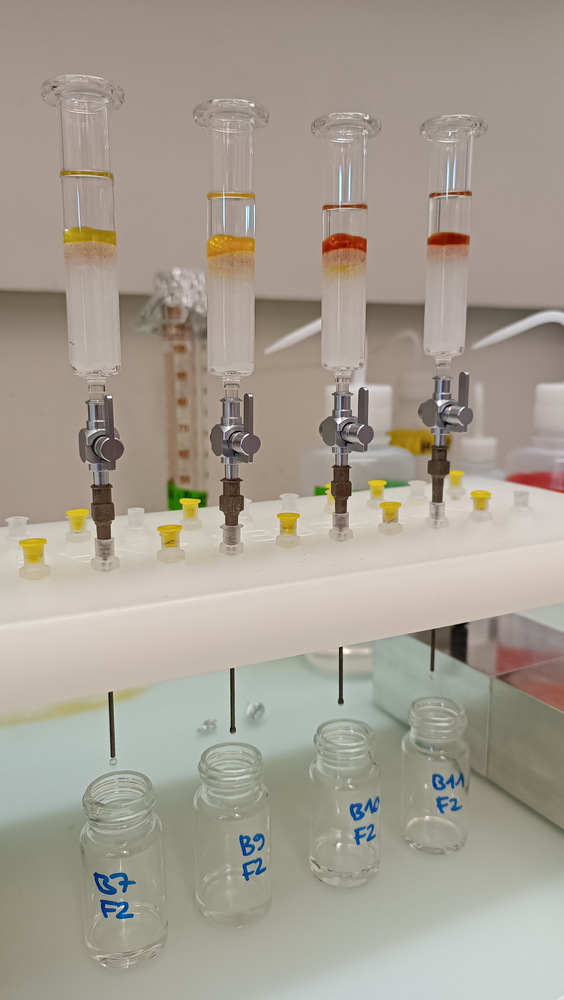

::: {.page-intro}
A selection of photographs from my research and scientific activities.
:::

```{=html}
<div class="photo-grid photo-grid--research">
  <figure>
    <a href="assets/photos/research-photo-01.jpg" aria-label="Open full photograph: Photograph from Ricardo N. Santos’s research gallery, image 1."></a>
  </figure>
  <figure>
    <a href="assets/photos/research-photo-02.jpg" aria-label="Open full photograph: Photograph from Ricardo N. Santos’s research gallery, image 2."></a>
  </figure>
  <figure>
    <a href="assets/photos/research-photo-03.jpg" aria-label="Open full photograph: Photograph from Ricardo N. Santos’s research gallery, image 3."></a>
  </figure>
  <figure>
    <a href="assets/photos/micadas-eth.jpg" aria-label="Open full photograph: MICADAS radiocarbon dating system at ETH."></a>
    <figcaption><strong>MICADAS radiocarbon dating system, ETH.</strong></figcaption>
  </figure>
  <figure>
    <a href="assets/photos/silica-column-fractionation.jpg" aria-label="Open full photograph: Silica-column fractionation setup."></a>
    <figcaption><strong>Silica-column fractionation.</strong></figcaption>
  </figure>
</div>
```
