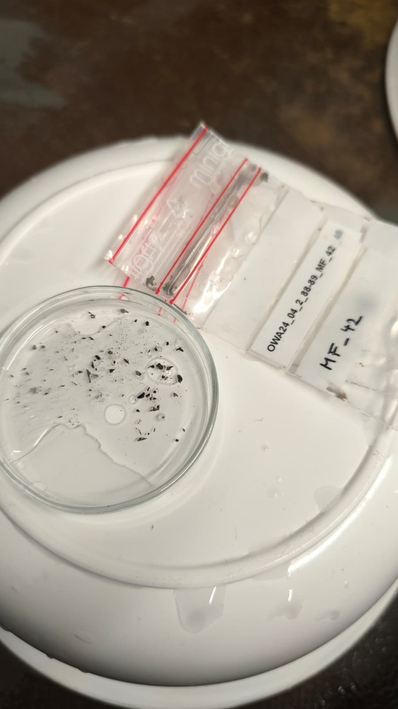
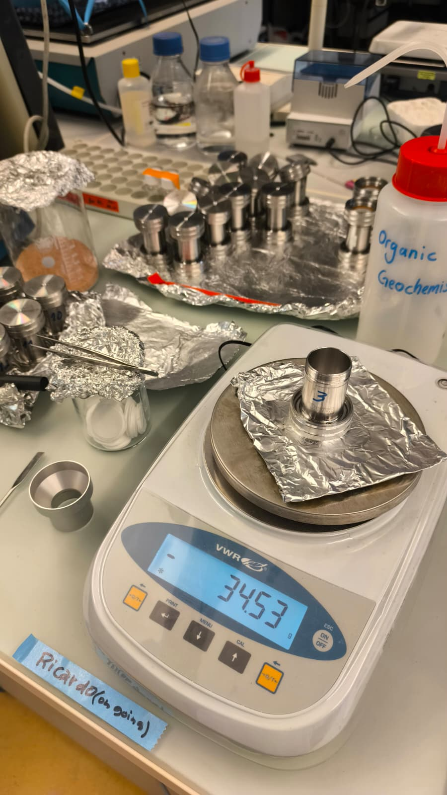
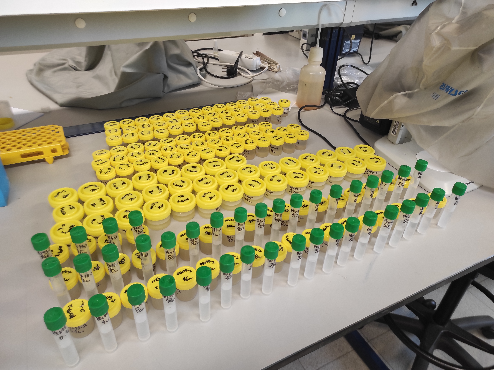

::: {.page-intro}
A selection of photographs from my research and scientific activities.
:::

```{=html}
<div class="photo-grid photo-grid--research">
  <figure>
    <a href="assets/photos/research-photo-01.jpg" aria-label="Open full photograph: GC-FID autosampler with Owasco samples."></a>
    <figcaption><strong>GC-FID autosampler with Owasco samples</strong></figcaption>
  </figure>
  <figure>
    <a href="assets/photos/research-photo-02.jpg" aria-label="Open full photograph: Aquatic macrophyte total lipid extract being prepared for the Rocket evaporator."></a>
    <figcaption><strong>Aquatic macrophyte TLE being prepared for the Rocket evaporator</strong></figcaption>
  </figure>
  <figure>
    <a href="assets/photos/research-photo-03.jpg" aria-label="Open full photograph: Sub-sampling for 210Pb and 137Cs measurements."></a>
    <figcaption><strong>Sub-sampling for <sup>210</sup>Pb and <sup>137</sup>Cs</strong></figcaption>
  </figure>
  <figure>
    <a href="assets/photos/micadas-eth.jpg" aria-label="Open full photograph: MICADAS radiocarbon dating system at ETH."></a>
    <figcaption><strong>MICADAS radiocarbon dating system, ETH.</strong></figcaption>
  </figure>
  <figure>
    <a href="assets/photos/silica-column-fractionation.jpg" aria-label="Open full photograph: Silica gel column chromatography setup."></a>
    <figcaption><strong>Silica Gel Column Chromatography</strong></figcaption>
  </figure>
  <figure>
    <a href="assets/photos/owasco-owa24-macrofossil-picking.jpeg" aria-label="Open full photograph: Macrofossils from OWA24 samples being picked into labelled bags."></a>
    <figcaption><strong>OWA24 Macrofossil Picking</strong></figcaption>
  </figure>
  <figure>
    <a href="assets/photos/ase-extraction-cell-assembly.jpeg" aria-label="Open full photograph: ASE extraction cells being assembled on a laboratory bench."></a>
    <figcaption><strong>ASE Extraction Cell Assembly</strong></figcaption>
  </figure>
  <figure>
    <a href="assets/photos/diatom-sample-preparation-a-coruna.jpg" aria-label="Open full photograph: Diatom sample preparation at the University of A Coruña."></a>
    <figcaption><strong>Diatom sample preparation at the University of A Coruña</strong></figcaption>
  </figure>
</div>
```
