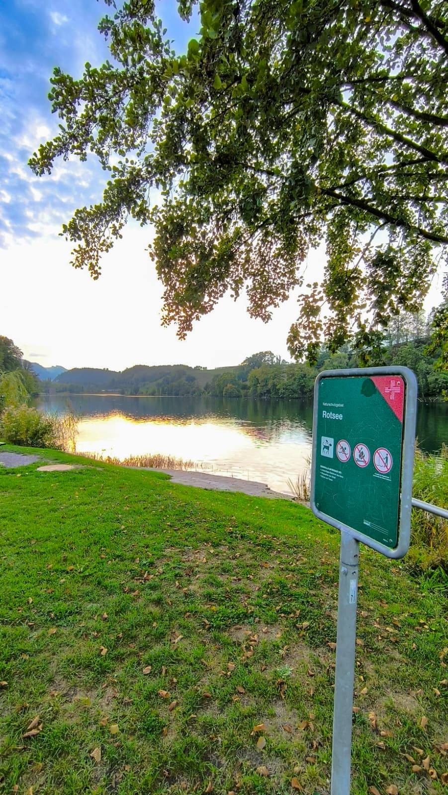
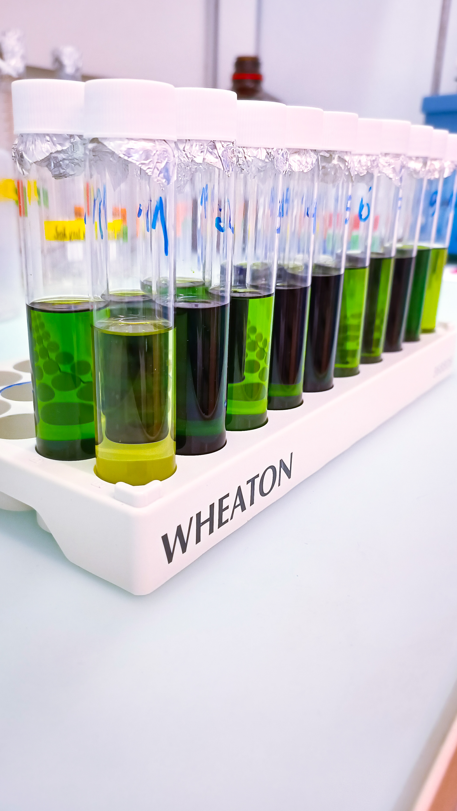
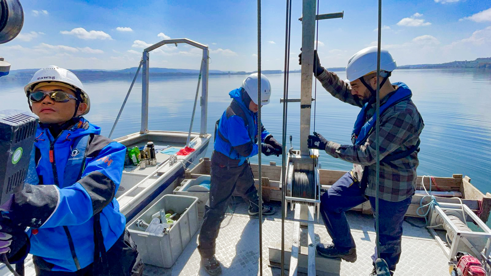
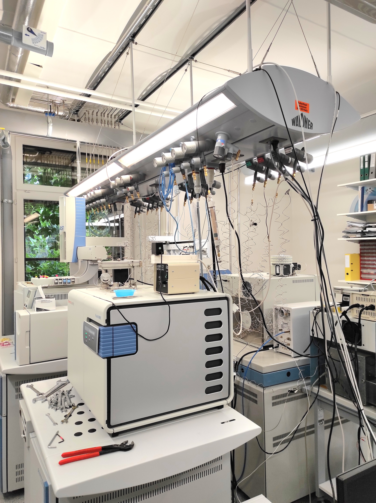
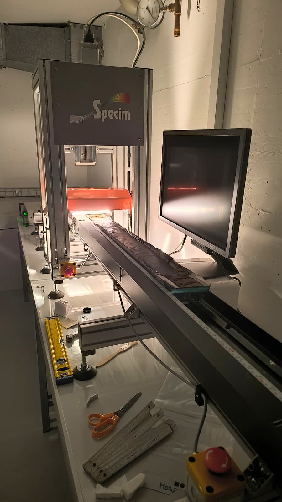

```{=html}
<section class="project-overview project-overview--with-photo" aria-label="Project overview">
<div class="project-overview-copy">
<p class="eyebrow">Temperate lakes · Germany · Switzerland · USA</p>
<p class="project-group">Ongoing project</p>
<p class="project-lead">Using lipid biomarkers and sedimentary DNA to understand how lake algal communities respond to natural change and human activity.</p>
<dl class="project-facts"><div><dt>Focus</dt><dd>Lake ecology · Hydroclimate</dd></div></dl>
<p><a class="project-more" href="https://duw.unibas.ch/en/forschungsgruppen/organic-geochemistry/adapt/">Project website <span aria-hidden="true">↗</span></a></p>
<div class="project-overview-notes"><p>This work formed part of my PhD in the Organic Geochemistry group at the University of Basel, supervised by <a href="https://duw.unibas.ch/en/research-groups/organic-geochemistry/team/ladd/">Prof. Nemiah Ladd</a>. I investigated how changes in lipid sources affect sedimentary records from temperate lakes in Europe and northeastern North America, and how these effects can be identified, quantified, and corrected.</p><p>Plant-derived lipids, including long-chain n-alkanes, fatty acids, and phytol, preserve evidence of past climate and vegetation. Their hydrogen-isotope values (δ²H) are particularly useful for reconstructing hydroclimate. Yet lipids reach sediments from both the lake and its catchment: shifts between aquatic and terrestrial plants, or between grasses and trees, can alter the isotope signal even when precipitation remains unchanged.</p><p>I combined modern calibration data with sediment records extending back to the last deglaciation. In northeastern Germany, I showed that charophytes and submerged vascular plants differ in their lipid production and hydrogen-isotope fractionation, with implications for how widely used aquatic biomarker indices are interpreted.</p><p>At Lake Rotsee in Switzerland and Owasco Lake in New York, I tested and applied a vegetation correction based on the relative abundances of long-chain n-alkanes. Accounting for vegetation effects substantially reduced abrupt late-Holocene isotope shifts associated with forest clearance and agricultural expansion. The corrected records reveal clearer, regionally coherent hydroclimate signals linked to insolation, ice-sheet retreat, and atmospheric circulation. Together, these results highlight the importance of accounting for source changes when interpreting sedimentary lipid δ²H.</p></div>
</div>
<figure class="project-photo"><figcaption>Lake Rotsee, Switzerland.</figcaption></figure>
</section>
```

::: {.project-contribution}
## My contribution

My contribution focuses on distinguishing hydroclimate signals from changes in the plants that supply lipids to lake sediments. I combine modern aquatic-plant calibration in northeastern Germany with vegetation-corrected plant-wax δ²H records from Lake Rotsee in Switzerland and Owasco Lake in New York.

This work tests how source changes affect aquatic biomarker indices and reduces vegetation-related shifts in sedimentary isotope records, helping reconstruct past hydroclimate and provide context for changes in lake ecosystems.

:::

## Research question

How can we distinguish hydroclimate signals from changes in terrestrial and aquatic plant sources in sedimentary lipid records?

## About the project

ADAPT (Algal Dynamics and Productivity through Time) is a Swiss National Science Foundation project investigating how lake algal communities respond to natural environmental change and human activity. It combines lipid biomarkers and sedimentary DNA to reconstruct past algal communities and their links to water quality, food webs, and carbon cycling.

My PhD contribution connects modern calibration studies in northeastern Germany with lake-sediment archives from Switzerland and northeastern North America. It develops ways to account for lipid source changes and reconstruct the climatic context of past ecosystem change.

ADAPT is funded through an SNSF Eccellenza Professorial Fellowship awarded to S. Nemiah Ladd.

## Approach

- **Modern calibration:** Compare lipid biomarkers and sedimentary DNA in water and surface sediments with living algal communities, and characterise lipid distributions and hydrogen-isotope fractionation in charophytes and submerged vascular plants.
- **Vegetation-corrected hydroclimate:** Use the relative abundances of long-chain n-alkanes to account for vegetation effects in plant-wax δ²H records from Rotsee and Owasco, and interpret climate change since the last deglaciation alongside other sedimentary evidence.
- **Past algal dynamics:** Investigate how nutrient enrichment, changes in water quality, and natural environmental variability have shaped algal communities throughout the Holocene. Swiss-lake studies address 20th-century phosphorus changes and Roman-period water-quality impacts. Comparable assessments of algal dynamics also include Owasco and Skaneateles lakes in New York, USA.
- **Aquatic sources and vegetation:** Combine lipid distributions, compound-specific δ²H and δ¹³C measurements, and modern calibration data to interpret aquatic biomarker indices and reconstruct changes in macroalgal abundance.

## Project images {#project-photos}

Select an image to view it in full.

```{=html}
<div class="project-gallery">
<figure class="project-gallery-photo">
<a class="project-gallery-link" href="../assets/projects/adapt-macrophytes-lipid-extraction.jpg" aria-label="Open full photograph: Total lipid extraction from aquatic macrophytes for ADAPT biomarker analyses."></a>
<figcaption>Total lipid extraction from aquatic macrophytes.</figcaption>
</figure>
<figure class="project-gallery-photo">
<a class="project-gallery-link" href="../assets/projects/adapt-lake-murten-coring.jpg" aria-label="Open full photograph: Researchers operating sediment-coring equipment on a boat at Lake Murten, Switzerland."></a>
<figcaption>Sediment coring at Lake Murten, Switzerland.</figcaption>
</figure>
<figure class="project-gallery-photo">
<a class="project-gallery-link" href="../assets/projects/adapt-basel-stable-isotope-lab.jpg" aria-label="Open full photograph: The Stable Isotope Ecology Lab in Basel, where compound-specific isotope analyses were carried out."></a>
<figcaption>Compound-specific isotope analyses at the Stable Isotope Ecology Lab, Basel.</figcaption>
</figure>
<figure class="project-gallery-photo">
<a class="project-gallery-link" href="../assets/projects/adapt-owasco-hyperspectral-analysis.jpeg" aria-label="Open full photograph: An Owasco Lake sediment core positioned in a hyperspectral scanner at the University of Bern."></a>
<figcaption>Hyperspectral analysis of Owasco Lake sediments at the University of Bern.</figcaption>
</figure>
</div>
```

## Publications

```{=html}
<article class="publication" data-doi="10.1029/2025PA005401">
<h3><a href="https://doi.org/10.1029/2025PA005401">Central European Hydroclimate Since the Younger Dryas Inferred From Vegetation-Corrected Sedimentary Plant Wax δ²H Values</a></h3>
<p class="authors"><strong>Santos, R. N.</strong>, Nelson, D. B., Klatt, A., Schubert, C. J., Dubois, N., de Jonge, C., &amp; Ladd, S. N.</p>
<p class="journal"><em>Paleoceanography and Paleoclimatology</em> · 2026</p>
<p class="doi"><a href="https://doi.org/10.1029/2025PA005401">DOI: 10.1029/2025PA005401 ↗</a></p>
</article>
```

## Funding {#funding}

```{=html}
<div class="project-funding-block">
<figure class="project-funder-logo"></figure>
<dl class="project-facts project-funding">
<div><dt>Funder</dt><dd>Swiss National Science Foundation (SNSF)</dd></div>
<div><dt>Grant</dt><dd><a href="https://data.snf.ch/grants/grant/194211">PCEFP2_194211</a></dd></div>
</dl>
</div>
```

::: {.project-page-links}
[← Ongoing projects](../research.qmd#ongoing-projects) · [Publications & outreach](../publications.qmd) · [Get in touch](../contact.qmd)
:::
