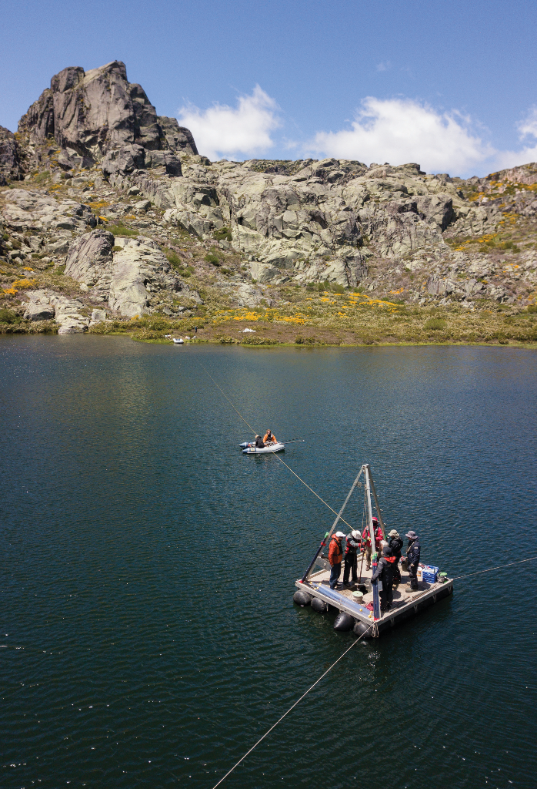
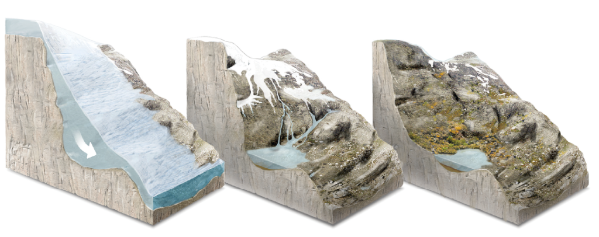
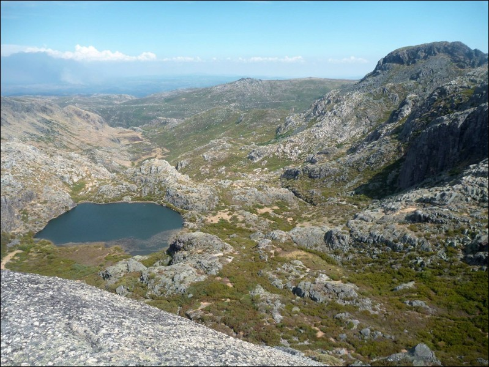
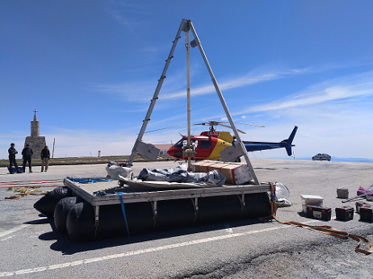
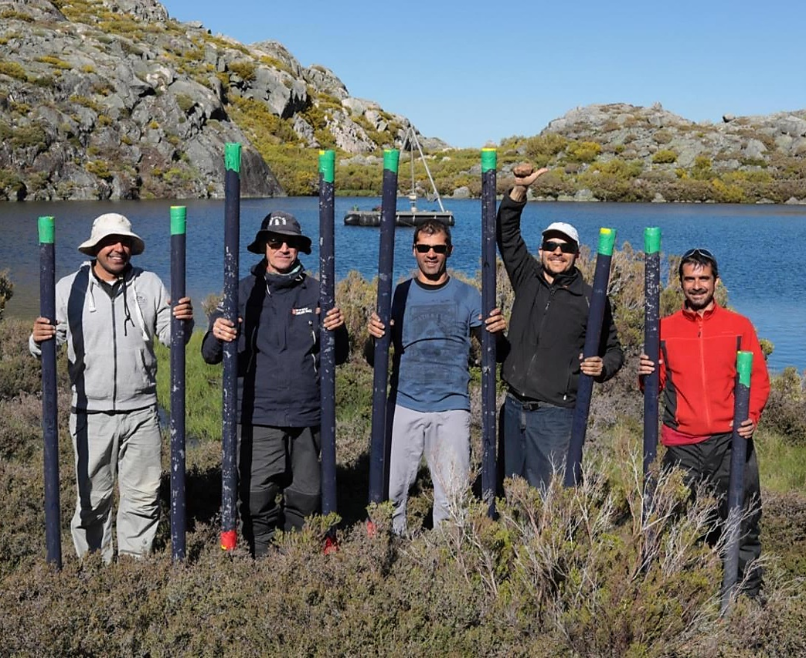
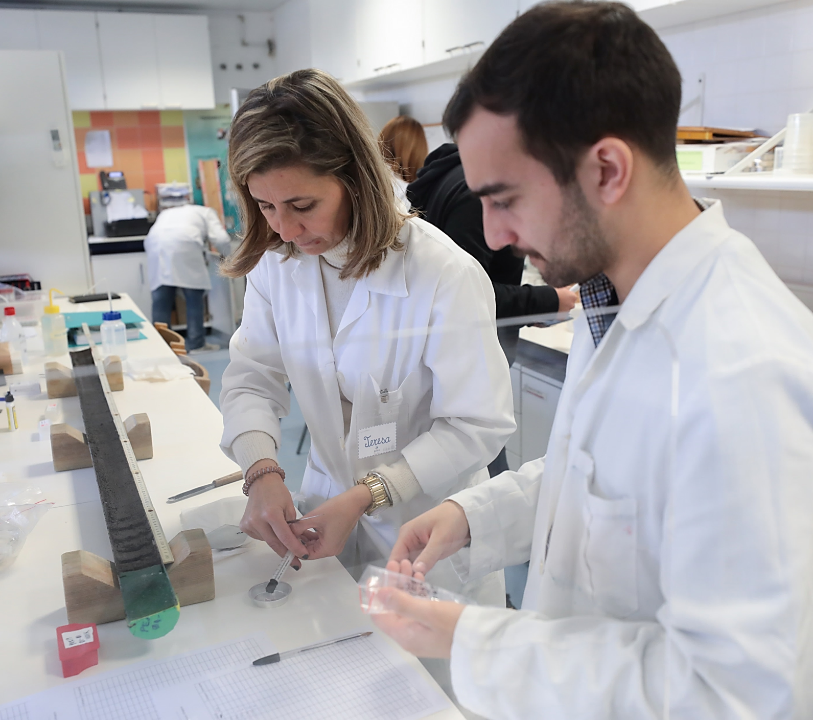

```{=html}
<section class="project-overview project-overview--with-photo" aria-label="Project overview">
<div class="project-overview-copy">
<p class="eyebrow">Serra da Estrela · Portugal</p>
<p class="project-group">Past project</p>
<p class="project-lead">Reading the Lake Peixão sediment archive to understand climate, vegetation, and environmental change in western Iberia.</p>
<dl class="project-facts"><div><dt>Focus</dt><dd>North Atlantic climate · Western Iberia</dd></div></dl>
<p><a class="project-more" href="https://holmodrive.rd.ciencias.ulisboa.pt/index.html">Project website <span aria-hidden="true">↗</span></a></p>
<div class="project-overview-notes"><p>During my time at IPMA and the University of Lisbon, I worked on Lake Peixão, a small glacial lake at around 1,700 m in Serra da Estrela. Its position between Atlantic and Mediterranean climate influences makes its sediments a sensitive archive of environmental change in western Iberia.</p><p>I led the organic geochemistry work on the PEX19-01 sediment core, analysing leaf-wax n-alkanes and their compound-specific δ²H and δ¹³C values.</p></div>
</div>
<figure class="project-photo"><figcaption>Sediment coring at Lake Peixão, Serra da Estrela, Portugal. Photograph: <a href="https://filipepatrocinio.com/">Filipe Patrocínio</a></figcaption></figure>
</section>
```

::: {.project-contribution}
## My contribution

I began by characterising the leaf-wax n-alkane distributions and isotopic signatures of dominant plants, soil, and surface sediment around the lake. This calibration identified the δ²H of the C₂₉ n-alkane as a robust indicator of terrestrial hydrology in Lake Peixão sediments and established a baseline for interpreting leaf-wax records in western Iberia.

I then applied these proxies downcore to reconstruct vegetation and hydroclimate over the last 2,000 years. The record documents shifts in Atlantic and Mediterranean climate influences through the Medieval Climate Anomaly and the Little Ice Age, linking vegetation change to large-scale atmospheric dynamics.

I also contributed to multi-proxy studies of the core’s chronology, deglaciation, and Saharan dust and sea-salt inputs since the Late Glacial.

:::

## Research question

How have North Atlantic climate variability, vegetation, and human activity shaped the environment around Lake Peixão?

## About the project

HOLMODRIVE investigated how North Atlantic atmospheric patterns have influenced western Iberian climate from the Late Glacial to the present. At Lake Peixão in Portugal’s Serra da Estrela, the sediment archive records changes in climate, vegetation, and the surrounding landscape.

## Approach

Lipid biomarkers and compound-specific stable isotopes alongside pollen, sedimentology, and inorganic geochemistry.

## Project images {#project-photos}

Select an image to view it in full.

```{=html}
<div class="project-gallery">
<figure class="project-gallery-photo project-gallery-photo--wide">
<a class="project-gallery-link" href="../assets/outreach/peixao-glacial-lake-formation.png" aria-label="Open full illustration: Three-stage illustration of Lake Peixão’s formation: a glacier fills a rocky basin, the ice retreats and meltwater collects, and the lake remains after deglaciation."></a>
<figcaption>From glacier to lake: the formation of Lake Peixão. Source: <a href="https://www.nationalgeographic.pt/meio-ambiente/o-tempo-preso-na-lagoa-do-peixao-na-serra-da-estrela_3781">National Geographic Portugal</a></figcaption>
</figure>
<figure class="project-gallery-photo">
<a class="project-gallery-link" href="../assets/projects/holmodrive-peixao-landscape.jpg" aria-label="Open full photograph: Lake Peixão surrounded by rocky slopes in Serra da Estrela, Portugal."></a>
<figcaption>Lake Peixão and the Serra da Estrela landscape</figcaption>
</figure>
<figure class="project-gallery-photo">
<a class="project-gallery-link" href="../assets/projects/holmodrive-peixao-coring-equipment.png" aria-label="Open full photograph: Sediment-coring platform with a tall tripod beside a helicopter."></a>
<figcaption>Sediment-coring equipment</figcaption>
</figure>
<figure class="project-gallery-photo">
<a class="project-gallery-link" href="../assets/projects/holmodrive-peixao-field-team.png" aria-label="Open full photograph: Five researchers holding sediment-core tubes beside Lake Peixão."></a>
<figcaption>The field team with sediment cores at Lake Peixão</figcaption>
</figure>
<figure class="project-gallery-photo">
<a class="project-gallery-link" href="../assets/projects/holmodrive-peixao-laboratory.png" aria-label="Open full photograph: Researchers in laboratory coats examining sediment samples beside an opened sediment core."></a>
<figcaption>Working with the sediment archive in the laboratory</figcaption>
</figure>
</div>
```

## Publications

Listed from oldest to newest.

```{=html}
<article class="publication" data-doi="10.3389/fenvs.2022.994377">
<h3><a href="https://doi.org/10.3389/fenvs.2022.994377">Leaf wax biomarkers of a high-mountain lake area in western Iberia—Implications for environmental reconstructions</a></h3>
<p class="authors"><strong>Santos, R. N.</strong>, Schefuß, E., Cordeiro, L. G., Oliveira, D., Hernández, A., Ramos, A. M., &amp; Rodrigues, T.</p>
<p class="journal"><em>Frontiers in Environmental Science</em> · 2022</p>
<p class="doi"><a href="https://doi.org/10.3389/fenvs.2022.994377">DOI: 10.3389/fenvs.2022.994377 ↗</a></p>
</article>
<article class="publication" data-doi="10.1002/esp.5536">
<h3><a href="https://doi.org/10.1002/esp.5536">The timing of the deglaciation in the Atlantic Iberian mountains: Insights from the stratigraphic analysis of a lake sequence in Serra da Estrela (Portugal)</a></h3>
<p class="authors">Hernández, A., Sáez, A., <strong>Santos, R. N.</strong>, Rodrigues, T., Martin-Puertas, C., Gil-Romera, G., Abbott, M., Carballeira, R., Costa, P., Giralt, S., Gomes, S. D., Griffore, M., Ibañez-Insa, J., Leira, M., Moreno, J., Naughton, F., Oliveira, D., Raposeiro, P. M., Trigo, R. M., Vieira, G., &amp; Ramos, A. M.</p>
<p class="journal"><em>Earth Surface Processes and Landforms</em> · 2023</p>
<p class="doi"><a href="https://doi.org/10.1002/esp.5536">DOI: 10.1002/esp.5536 ↗</a></p>
</article>
<article class="publication" data-doi="10.1016/j.scitotenv.2023.166179">
<h3><a href="https://doi.org/10.1016/j.scitotenv.2023.166179">Identifying imprints of externally derived dust and halogens in the sedimentary record of an Iberian alpine lake for the past ∼13,500 years – Lake Peixão, Serra da Estrela (Central Portugal)</a></h3>
<p class="authors">Moreno, J., Ramos, A., Raposeiro, P. M., <strong>Santos, R. N.</strong>, Rodrigues, T., Naughton, F., Moreno, F., Trigo, R. M., Ibañez-Insa, J., Ludwig, P., Shi, X., &amp; Hernández, A.</p>
<p class="journal"><em>Science of The Total Environment</em> · 2023</p>
<p class="doi"><a href="https://doi.org/10.1016/j.scitotenv.2023.166179">DOI: 10.1016/j.scitotenv.2023.166179 ↗</a></p>
</article>
<article class="publication" data-doi="10.1016/j.quascirev.2024.108796">
<h3><a href="https://doi.org/10.1016/j.quascirev.2024.108796">Understanding the Atlantic influence on climate and vegetation dynamics in western Iberia over the last 2000 years</a></h3>
<p class="authors"><strong>Santos, R. N.</strong>, Rodrigues, T., Naughton, F., Schefuß, E., Oliveira, D., Moreno, J., Raposeiro, P. M., Gil-Romera, G., Morgan, A., Leira, M., Gomes, S. D., Ladd, S. N., Trigo, R. M., Ramos, A. M., &amp; Hernández, A.</p>
<p class="journal"><em>Quaternary Science Reviews</em> · 2024</p>
<p class="doi"><a href="https://doi.org/10.1016/j.quascirev.2024.108796">DOI: 10.1016/j.quascirev.2024.108796 ↗</a></p>
</article>
<article class="publication" data-doi="10.1029/2026PA005517">
<h3><a href="https://doi.org/10.1029/2026PA005517">North Atlantic ocean–atmosphere dynamics controlled the hydroclimate in western Iberia during the Holocene</a></h3>
<p class="authors">Fernández-Pérez, U., <strong>Santos, R. N.</strong>, Rodrigues, T., Schefuß, E., Bao, R., Raposeiro, P., et al.</p>
<p class="journal"><em>Paleoceanography and Paleoclimatology</em> · 2026</p>
<p class="doi"><a href="https://doi.org/10.1029/2026PA005517">DOI: 10.1029/2026PA005517 ↗</a></p>
</article>
```

## Outreach {.outreach}

```{=html}
<article class="publication outreach-item outreach-item--with-image">
<figure class="outreach-image"><a href="https://www.nationalgeographic.pt/meio-ambiente/o-tempo-preso-na-lagoa-do-peixao-na-serra-da-estrela_3781"></a></figure>
<div class="outreach-copy">
<h3><a href="https://www.nationalgeographic.pt/meio-ambiente/o-tempo-preso-na-lagoa-do-peixao-na-serra-da-estrela_3781">O tempo preso na lagoa do Peixão, na Serra da Estrela</a></h3>
<p class="journal"><em>National Geographic Portugal · Portuguese</em></p>
<p class="authors">Outreach on our research at Lagoa do Peixão in Serra da Estrela, Portugal.</p>
<p class="outreach-credit">Text and photography: <a href="https://filipepatrocinio.com/">Filipe Patrocínio</a></p>
<p class="doi"><a href="https://www.nationalgeographic.pt/meio-ambiente/o-tempo-preso-na-lagoa-do-peixao-na-serra-da-estrela_3781">Read feature ↗</a></p>
</div>
</article>
<article class="publication outreach-item outreach-item--with-image">
<figure class="outreach-image"><a href="https://youtu.be/WWDSYIWuOYk" class="outreach-video-link" aria-label="Watch Lake Peixão project video on YouTube"><span class="outreach-play" aria-hidden="true"><svg viewBox="0 0 24 24" width="20" height="20" fill="currentColor"><path d="M7 4v16l14-8z"/></svg></span></a></figure>
<div class="outreach-copy">
<h3><a href="https://youtu.be/WWDSYIWuOYk">Lake Peixão project video</a></h3>
<p class="journal"><em>YouTube</em></p>
<p class="authors">A video I made while working on the HOLMODRIVE project at Lake Peixão.</p>
<p class="doi"><a href="https://youtu.be/WWDSYIWuOYk">Watch on YouTube ↗</a></p>
</div>
</article>
```

::: {.project-page-links}
[← Past projects](../research.qmd#past-projects) · [Publications & outreach](../publications.qmd) · [Get in touch](../contact.qmd)
:::
