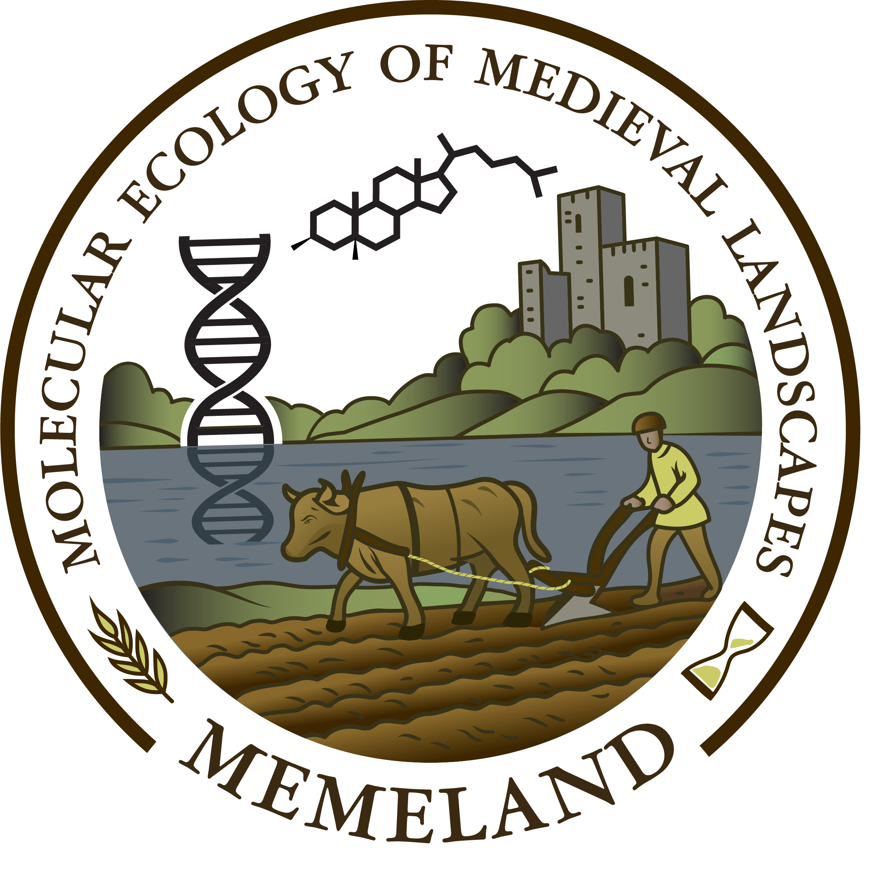

```{=html}
<section class="project-overview project-overview--with-photo" aria-label="Project overview">
<div class="project-overview-copy">
<p class="eyebrow">European landscapes</p>
<p class="project-group">Ongoing project</p>
<p class="project-lead">Reconstructing medieval land use from lake sediments, using fecal and plant biomarkers to trace farming practices and environmental impacts.</p>
<dl class="project-facts"><div><dt>Focus</dt><dd>Medieval land use · Molecular biomarkers</dd></div><div><dt>My role</dt><dd>Fecal and plant biomarker research · Eawag team</dd></div></dl>
<p><a class="project-more" href="https://memeland.no/en/About/about.html">Project website <span aria-hidden="true">↗</span></a></p>
</div>
<figure class="project-photo project-logo"><figcaption>MEMELAND · Molecular Ecology of Medieval Landscapes</figcaption></figure>
</section>
```

::: {.project-contribution}
## My contribution

I will join Prof. [Nathalie Dubois](https://memeland.no/en/Team/people.html#prof.-dr.-nathalie-dubois) in the Eawag team’s biomarker work, using lake sediments to reconstruct medieval agricultural practices and their effects on aquatic ecosystems.

:::

## Research question

How can molecular traces in lake sediments reveal medieval farming practices and their environmental impacts?

## About the project

MEMELAND investigates how human land use has shaped European landscapes and biodiversity over the last two millennia. It combines lake-sediment archives with archaeological, palaeoecological, and molecular evidence to distinguish local land-use histories from regional change.

Read more about [the Eawag team’s research](https://memeland.no/en/Team/eawag.html).

## Approach

- **Grazing and manuring:** Fecal sterols and bile acids will trace animal and human inputs, complement animal sedimentary DNA records, and test links between nutrient enrichment and low-oxygen lake conditions.
- **Soil erosion:** Compound-specific radiocarbon dating of leaf waxes and refractory organic carbon analyses will investigate soil disturbance linked to ploughing and livestock.
- **Crop cultivation:** Miliacin (millet) and cannabinol (*Cannabis* spp.) will be used to investigate cultivation and practices such as hemp retting.

Biomarker records will be integrated with hyperspectral imaging and geochemical and chronological data from the University of Salzburg team. Together with archaeobotany, sedimentary DNA, and socio-environmental modelling, these records will help compare medieval agricultural practices across Europe.

::: {.project-page-links}
[← Ongoing projects](../research.qmd#ongoing-projects) · [Publications & outreach](../publications.qmd) · [Get in touch](../contact.qmd)
:::
