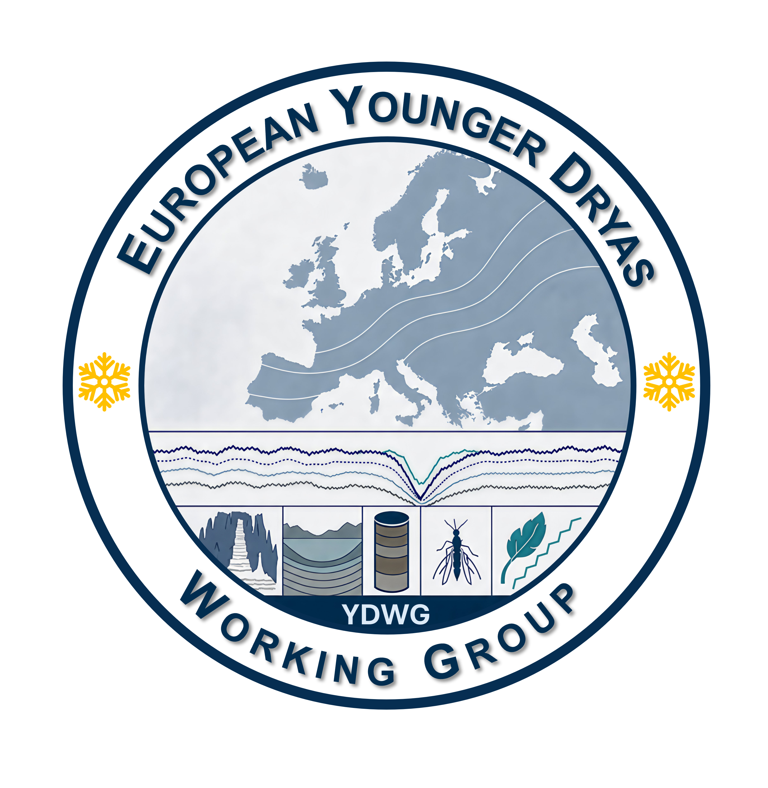
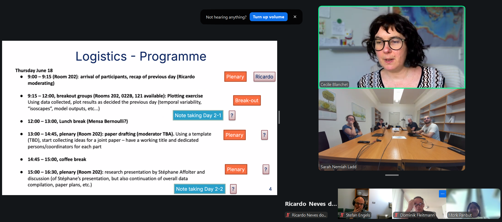
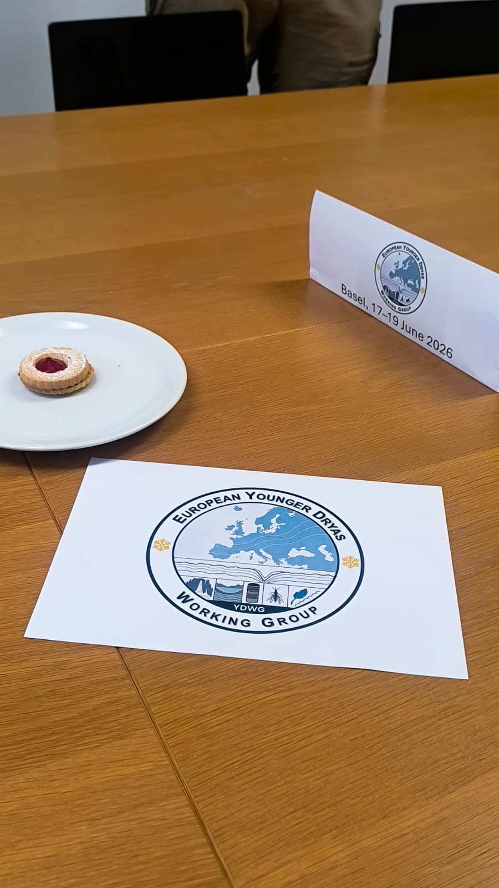

```{=html}
<section class="project-overview project-overview--with-photo" aria-label="Project overview">
<div class="project-overview-copy">
<p class="eyebrow">Europe · Mediterranean · Lateglacial</p>
<p class="project-group">Ongoing project</p>
<p class="project-lead">An international working group integrating lake, cave, glacier, and model evidence to understand European hydroclimate during the Younger Dryas and the last deglaciation.</p>
<dl class="project-facts"><div><dt>Focus</dt><dd>Hydroclimate · Proxy–model integration</dd></div><div><dt>Period</dt><dd>September 2024–present</dd></div><div><dt>My role</dt><dd>Co-coordinator · Lake-sediment biomarker synthesis</dd></div></dl>
<div class="project-overview-notes"><p>I co-coordinate the group with <a href="https://www.gfz.de/en/staff/cecile.blanchet/sec46">Cecile Blanchet</a> (GFZ Potsdam). My role centres on lake-sediment biomarker research, compiling compound-specific plant-wax δ²H records and developing consistent methods to compare them across sites.</p></div>
</div>
<figure class="project-photo project-logo"></figure>
</section>
```

::: {.project-contribution}
## My contribution

I coordinate the lake-sediment group and am building a European compilation of Lateglacial plant-wax δ²H records covering approximately 15–10.5 cal ka BP.

I am developing a consistent workflow to calculate isotopic offsets across the Allerød/Younger Dryas and Younger Dryas/Holocene transitions. It accounts for age-model uncertainty near interval boundaries and documents which samples are excluded.

:::

## Research question

How did large-scale forcing, such as an AMOC slowdown, express itself regionally across Europe during the last deglaciation and early Holocene? How did hydroclimate change across the Bølling–Allerød, Younger Dryas, and early Holocene in Europe, and can proxy records and isotope-enabled models tell a consistent story?

## About the project

This group brings together researchers working on lake sediments, speleothems, glaciers, climate models and multiple proxies to build a continent-scale understanding of the Younger Dryas and the wider last deglaciation in Europe.

Many excellent records exist but are usually discussed within separate regional or proxy-specific contexts. We compile, critically evaluate and compare them, paying close attention to chronological control, proxy sensitivity, seasonality and uncertainty.

## Approach

- **Data compilation:** Collect and harmonise published records in a shared template, using community databases such as SISAL for speleothems and LiPDverse for lake records as starting points.
- **Offset analysis:** Calculate Allerød→Younger Dryas and Younger Dryas→Holocene isotopic offsets from curated interval means, with tiers of chronological reliability and tests of boundary sensitivity.
- **Proxy comparison:** Compare plant-wax δ²H changes with European speleothem δ¹⁸O records, followed by glacier and sediment-pigment evidence.
- **Model benchmarking:** Use the combined synthesis to evaluate isotope-enabled climate model simulations of the Younger Dryas.

## Collaborators

Collaborators include [Cecile Blanchet](https://www.gfz.de/en/staff/cecile.blanchet/sec46), [S. Nemiah Ladd](https://duw.unibas.ch/en/research-groups/organic-geochemistry/team/ladd/), Laura Endres, Stan Schouten, Brooke Snoll, Chanamon (Mork) Panbut, Andrea Columbu, Costanza Del Gobbo, Stéphane Affolter, Dominik Fleitmann, Francien Peterse, Brice Rea, Matteo Spagnolo, and others.

The group brings together colleagues from GFZ Potsdam, Basel, Bern, Pisa, Aberdeen, Utrecht, Leeds, and other institutions.

## Project images {#project-photos}

Select an image to view it in full.

```{=html}
<div class="project-gallery">
<figure class="project-gallery-photo">
<a class="project-gallery-link" href="../assets/projects/younger-dryas-basel-hybrid-meeting.png" aria-label="Open full photograph: Video call showing the Basel meeting programme, remote participants, and working group members in a conference room."></a>
<figcaption>Basel meeting, 18 June 2026: programme and hybrid discussion.</figcaption>
</figure>
<figure class="project-gallery-photo">
<a class="project-gallery-link" href="../assets/projects/younger-dryas-first-basel-meeting.jpeg" aria-label="Open full photograph: Working group logo and a sign for the Basel meeting on a conference table."></a>
<figcaption>First in-person meeting in Basel, 17–19 June 2026.</figcaption>
</figure>
</div>
```

::: {.project-page-links}
[← Ongoing projects](../research.qmd#ongoing-projects) · [Publications & outreach](../publications.qmd) · [Get in touch](../contact.qmd)
:::
