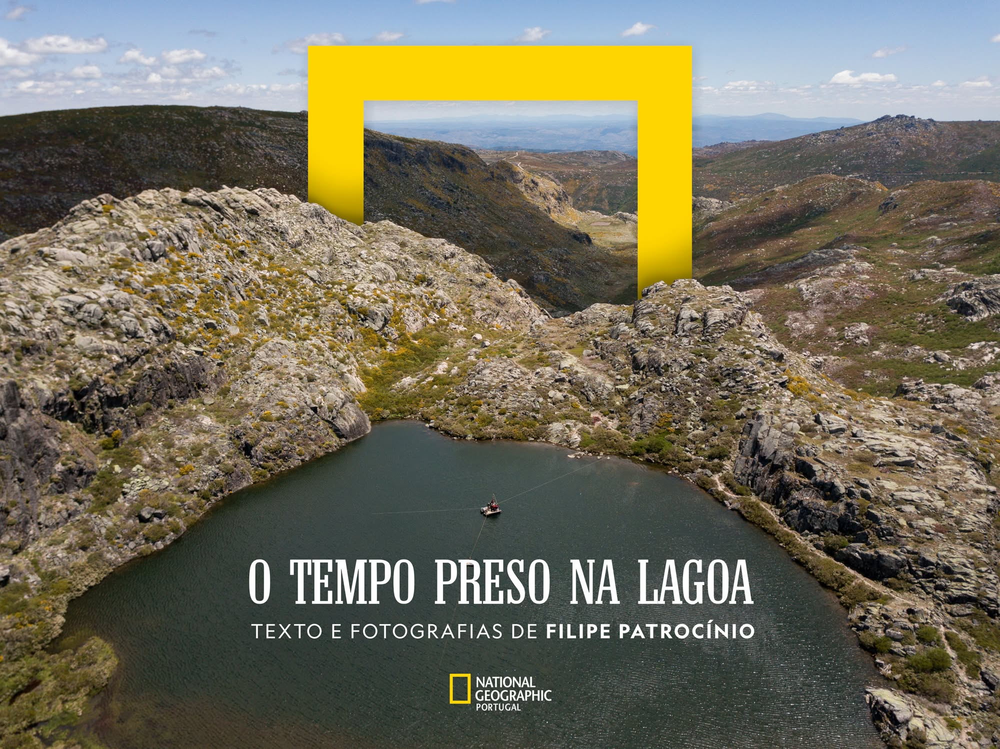
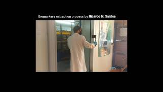
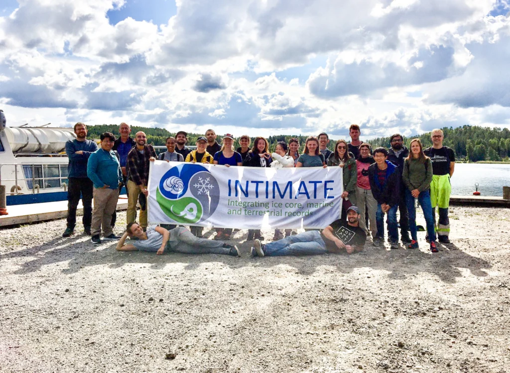
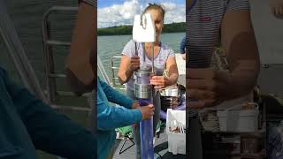

## Peer-reviewed publications

```{=html}
<h3 class="publication-year" id="publications-2026">2026</h3>
<article class="publication">
<h3><a href="https://doi.org/10.1029/2026PA005517">North Atlantic ocean–atmosphere dynamics controlled the hydroclimate in western Iberia during the Holocene</a></h3>
<p class="authors">Fernández-Pérez, U., <strong>Santos, R. N.</strong>, Rodrigues, T., Schefuß, E., Bao, R., Raposeiro, P., et al.</p>
<p class="journal"><em>Paleoceanography and Paleoclimatology</em> · 2026</p>
<p class="doi"><a href="https://doi.org/10.1029/2026PA005517">DOI: 10.1029/2026PA005517 ↗</a></p>
</article>
<article class="publication">
<h3><a href="https://doi.org/10.1016/j.quascirev.2026.110248">Multi-proxy reconstruction of Holocene paleoenvironmental changes in eastern Thailand: Sea-level and monsoon as key drivers</a></h3>
<p class="authors">Wangritthikraikul, K., Ladd, S. N., <strong>Santos, R. N.</strong>, Haghipour, N., Dubois, N., &amp; Chawchai, S.</p>
<p class="journal"><em>Quaternary Science Reviews, 392, 110248</em> · 2026</p>
<p class="doi"><a href="https://doi.org/10.1016/j.quascirev.2026.110248">DOI: 10.1016/j.quascirev.2026.110248 ↗</a></p>
</article>
<article class="publication">
<h3><a href="https://doi.org/10.1029/2025PA005401">Central European Hydroclimate Since the Younger Dryas Inferred From Vegetation-Corrected Sedimentary Plant Wax δ²H Values</a></h3>
<p class="authors"><strong>Santos, R. N.</strong>, Nelson, D. B., Klatt, A., Schubert, C. J., Dubois, N., de Jonge, C., &amp; Ladd, S. N.</p>
<p class="journal"><em>Paleoceanography and Paleoclimatology</em> · 2026</p>
<p class="doi"><a href="https://doi.org/10.1029/2025PA005401">DOI: 10.1029/2025PA005401 ↗</a></p>
</article>
<h3 class="publication-year" id="publications-2024">2024</h3>
<article class="publication">
<h3><a href="https://doi.org/10.1016/j.quascirev.2024.108796">Understanding the Atlantic influence on climate and vegetation dynamics in western Iberia over the last 2000 years</a></h3>
<p class="authors"><strong>Santos, R. N.</strong>, Rodrigues, T., Naughton, F., Schefuß, E., Oliveira, D., Moreno, J., Raposeiro, P. M., Gil-Romera, G., Morgan, A., Leira, M., Gomes, S. D., Ladd, S. N., Trigo, R. M., Ramos, A. M., &amp; Hernández, A.</p>
<p class="journal"><em>Quaternary Science Reviews</em> · 2024</p>
<p class="doi"><a href="https://doi.org/10.1016/j.quascirev.2024.108796">DOI: 10.1016/j.quascirev.2024.108796 ↗</a></p>
</article>
<article class="publication">
<h3><a href="https://doi.org/10.1016/j.quaint.2024.10.010">Environmental changes and historical occupation at Oued Laksar (Ksar Seghir), Morocco</a></h3>
<p class="authors">Costa, A. M., Freitas, M. D. C., Teixeira, A., Costa, P. J., <strong>Santos, R. N.</strong>, Cachão, M., Fatela, F., Pereira, R., Tereso, J. P., Lopes, V. P., Bao, R., &amp; El-Boudjay, A.</p>
<p class="journal"><em>Quaternary International</em> · 2024</p>
<p class="doi"><a href="https://doi.org/10.1016/j.quaint.2024.10.010">DOI: 10.1016/j.quaint.2024.10.010 ↗</a></p>
</article>
<h3 class="publication-year" id="publications-2023">2023</h3>
<article class="publication">
<h3><a href="https://doi.org/10.1016/j.scitotenv.2023.166179">Identifying imprints of externally derived dust and halogens in the sedimentary record of an Iberian alpine lake for the past ∼13,500 years – Lake Peixão, Serra da Estrela (Central Portugal)</a></h3>
<p class="authors">Moreno, J., Ramos, A., Raposeiro, P. M., <strong>Santos, R. N.</strong>, Rodrigues, T., Naughton, F., Moreno, F., Trigo, R. M., Ibañez-Insa, J., Ludwig, P., Shi, X., &amp; Hernández, A.</p>
<p class="journal"><em>Science of The Total Environment</em> · 2023</p>
<p class="doi"><a href="https://doi.org/10.1016/j.scitotenv.2023.166179">DOI: 10.1016/j.scitotenv.2023.166179 ↗</a></p>
</article>
<article class="publication">
<h3><a href="https://doi.org/10.1002/esp.5536">The timing of the deglaciation in the Atlantic Iberian mountains: Insights from the stratigraphic analysis of a lake sequence in Serra da Estrela (Portugal)</a></h3>
<p class="authors">Hernández, A., Sáez, A., <strong>Santos, R. N.</strong>, Rodrigues, T., Martin-Puertas, C., Gil-Romera, G., Abbott, M., Carballeira, R., Costa, P., Giralt, S., Gomes, S. D., Griffore, M., Ibañez-Insa, J., Leira, M., Moreno, J., Naughton, F., Oliveira, D., Raposeiro, P. M., Trigo, R. M., Vieira, G., &amp; Ramos, A. M.</p>
<p class="journal"><em>Earth Surface Processes and Landforms</em> · 2023</p>
<p class="doi"><a href="https://doi.org/10.1002/esp.5536">DOI: 10.1002/esp.5536 ↗</a></p>
</article>
<h3 class="publication-year" id="publications-2022">2022</h3>
<article class="publication">
<h3><a href="https://doi.org/10.3389/fenvs.2022.994377">Leaf wax biomarkers of a high-mountain lake area in western Iberia—Implications for environmental reconstructions</a></h3>
<p class="authors"><strong>Santos, R. N.</strong>, Schefuß, E., Cordeiro, L. G., Oliveira, D., Hernández, A., Ramos, A. M., &amp; Rodrigues, T.</p>
<p class="journal"><em>Frontiers in Environmental Science</em> · 2022</p>
<p class="doi"><a href="https://doi.org/10.3389/fenvs.2022.994377">DOI: 10.3389/fenvs.2022.994377 ↗</a></p>
</article>
```

## Outreach {.outreach}

```{=html}
<article class="publication outreach-item outreach-item--with-image">
<figure class="outreach-image"><a href="https://www.nationalgeographic.pt/meio-ambiente/o-tempo-preso-na-lagoa-do-peixao-na-serra-da-estrela_3781"></a></figure>
<div class="outreach-copy">
<h3><a href="https://www.nationalgeographic.pt/meio-ambiente/o-tempo-preso-na-lagoa-do-peixao-na-serra-da-estrela_3781">O tempo preso na lagoa do Peixão, na Serra da Estrela</a></h3>
<p class="journal"><em>National Geographic Portugal · Portuguese</em></p>
<p class="authors">Outreach on our research at Lagoa do Peixão in Serra da Estrela, Portugal.</p>
<p class="outreach-credit">Text and photography: <a href="https://filipepatrocinio.com/">Filipe Patrocínio</a></p>
<p class="doi"><a href="https://www.nationalgeographic.pt/meio-ambiente/o-tempo-preso-na-lagoa-do-peixao-na-serra-da-estrela_3781">Read feature ↗</a></p>
</div>
</article>
<article class="publication outreach-item outreach-item--with-image">
<figure class="outreach-image"><a href="https://youtu.be/WWDSYIWuOYk" class="outreach-video-link" aria-label="Watch Lake Peixão project video on YouTube"><span class="outreach-play" aria-hidden="true"><svg viewBox="0 0 24 24" width="20" height="20" fill="currentColor"><path d="M7 4v16l14-8z"/></svg></span></a></figure>
<div class="outreach-copy">
<h3><a href="https://youtu.be/WWDSYIWuOYk">Lake Peixão project video</a></h3>
<p class="journal"><em>YouTube</em></p>
<p class="authors">A video I made while working on the HOLMODRIVE project at Lake Peixão.</p>
<p class="doi"><a href="https://youtu.be/WWDSYIWuOYk">Watch on YouTube ↗</a></p>
</div>
</article>
<article class="publication outreach-item outreach-item--with-image">
<figure class="outreach-image"><a href="https://blogs.egu.eu/divisions/cl/2022/11/21/a-glimpse-into-the-intimates-summer-school-of-2022/"></a></figure>
<div class="outreach-copy">
<h3><a href="https://blogs.egu.eu/divisions/cl/2022/11/21/a-glimpse-into-the-intimates-summer-school-of-2022/">A glimpse into the INTIMATE Summer School 2022</a></h3>
<p class="journal"><em>EGU Climate blog · 2022</em></p>
<p class="outreach-award"><strong>EGU Best Blog Post Award · Public vote</strong></p>
<p class="authors">Reflections on paleoclimate research, sediment fieldwork, and collaboration at the INTIMATE Summer School in Finland.</p>
<p class="outreach-credit">Photograph: Francesco Muschitiello</p>
<p class="doi"><a href="https://blogs.egu.eu/divisions/cl/2022/11/21/a-glimpse-into-the-intimates-summer-school-of-2022/">Read blog post ↗</a></p>
</div>
</article>
<article class="publication outreach-item outreach-item--with-image">
<figure class="outreach-image"><a href="https://www.youtube.com/watch?v=2F66bkFZ7iA" class="outreach-video-link" aria-label="Watch INTIMATE Summer School 2022 highlights on YouTube"><span class="outreach-play" aria-hidden="true"><svg viewBox="0 0 24 24" width="20" height="20" fill="currentColor"><path d="M7 4v16l14-8z"/></svg></span></a></figure>
<div class="outreach-copy">
<h3><a href="https://www.youtube.com/watch?v=2F66bkFZ7iA">INTIMATE Summer School 2022 highlights</a></h3>
<p class="journal"><em>YouTube</em></p>
<p class="authors">Highlights from the INTIMATE Summer School 2022 in Finland.</p>
<p class="doi"><a href="https://www.youtube.com/watch?v=2F66bkFZ7iA">Watch on YouTube ↗</a></p>
</div>
</article>
```
