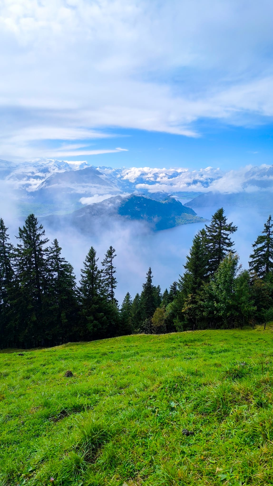

::: {.research-overview-intro}

::: {.page-intro}
I use lipid biomarkers to reconstruct past climates, ecosystems, and human impacts from lake sediments. My work combines molecular distributions and compound-specific δ²H and δ¹³C measurements with other evidence preserved in these natural archives.

Interpreting these records requires understanding both environmental conditions and the organisms that produce the molecules we measure. I combine modern calibration studies with sedimentary records to investigate source effects, refine biomarker proxies, and make the uncertainties in past environmental reconstructions explicit.
:::

```{=html}
<figure class="research-intro-photo">
<a href="assets/photos/research-introduction.jpeg" aria-label="Open full photograph: A mountain lake framed by conifer trees, green slopes, and low clouds."></a>
</figure>
```

:::

```{=html}
<nav class="project-jumps" aria-label="Research sections">
<a href="#ongoing-projects">Ongoing projects <span aria-hidden="true">↓</span></a>
<a href="#past-projects">Past projects <span aria-hidden="true">↓</span></a>
</nav>
```

## Ongoing projects {#ongoing-projects}

```{=html}
<div class="projects-grid projects-grid--ongoing">
<article class="project-card">
<a class="project-photo-link" href="projects/memeland.html" aria-label="Explore MEMELAND">
<figure class="project-photo project-logo"></figure>
</a>
<div class="project-card-copy">
<p class="eyebrow">European landscapes</p>
<h3><a href="projects/memeland.html">MEMELAND</a></h3>
<p>Reconstructing medieval land use from lake sediments, using fecal and plant biomarkers to trace farming practices and environmental impacts.</p>
<p class="project-phase">Medieval land use · Molecular biomarkers</p>
<a class="project-more" href="projects/memeland.html">Explore project <span aria-hidden="true">→</span></a>
</div>
</article>
<article class="project-card">
<a class="project-photo-link" href="projects/younger-dryas.html" aria-label="Explore Younger Dryas Working Group">
<figure class="project-photo project-logo"></figure>
</a>
<div class="project-card-copy">
<p class="eyebrow">Europe · Mediterranean · Lateglacial</p>
<h3><a href="projects/younger-dryas.html">Younger Dryas Working Group</a></h3>
<p>An international working group integrating lake, cave, glacier, and model evidence to understand European hydroclimate during the Younger Dryas and the last deglaciation.</p>
<p class="project-phase">Hydroclimate · Proxy–model integration · September 2024–present</p>
<a class="project-more" href="projects/younger-dryas.html">Explore project <span aria-hidden="true">→</span></a>
</div>
</article>
<article class="project-card">
<a class="project-photo-link" href="projects/adapt.html" aria-label="Explore ADAPT">
<figure class="project-photo"></figure>
</a>
<div class="project-card-copy">
<p class="eyebrow">Temperate lakes · Germany · Switzerland · USA</p>
<h3><a href="projects/adapt.html">ADAPT</a></h3>
<p>Using lipid biomarkers and sedimentary DNA to understand how lake algal communities respond to natural change and human activity.</p>
<p class="project-phase">Lake ecology · Hydroclimate</p>
<a class="project-more" href="projects/adapt.html">Explore project <span aria-hidden="true">→</span></a>
</div>
</article>
</div>
```

## Past projects {#past-projects}

```{=html}
<div class="projects-grid projects-grid--past">
<article class="project-card">
<a class="project-photo-link" href="projects/holmodrive.html" aria-label="Explore HOLMODRIVE · Lake Peixão">
<figure class="project-photo"></figure>
</a>
<div class="project-card-copy">
<p class="eyebrow">Serra da Estrela · Portugal</p>
<h3><a href="projects/holmodrive.html">HOLMODRIVE · Lake Peixão</a></h3>
<p>Reading the Lake Peixão sediment archive to understand climate, vegetation, and environmental change in western Iberia.</p>
<p class="project-phase">North Atlantic climate · Western Iberia</p>
<p class="project-photo-credit">Photograph: <a href="https://filipepatrocinio.com/">Filipe Patrocínio</a></p>
<a class="project-more" href="projects/holmodrive.html">Explore project <span aria-hidden="true">→</span></a>
</div>
</article>
</div>
```

## Collaboration and scientific exchange

I welcome conversations about biomarker proxy development, vegetation correction, multi-proxy reconstructions, and human–environment interactions. [Get in touch →](contact.qmd)
